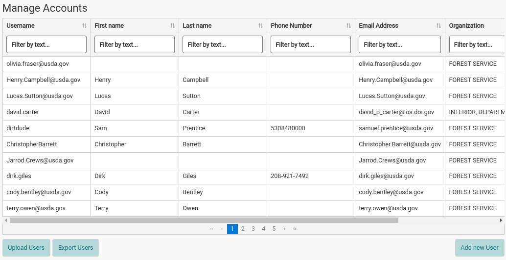
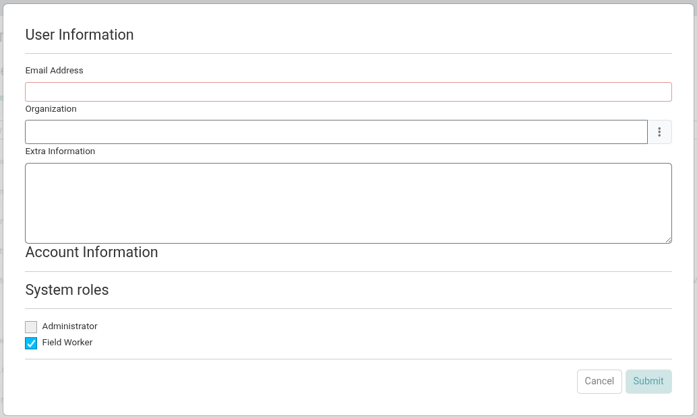
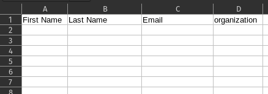
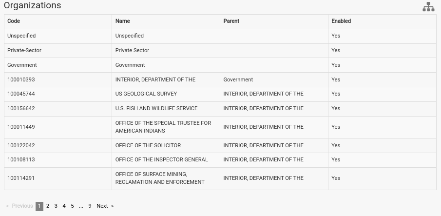
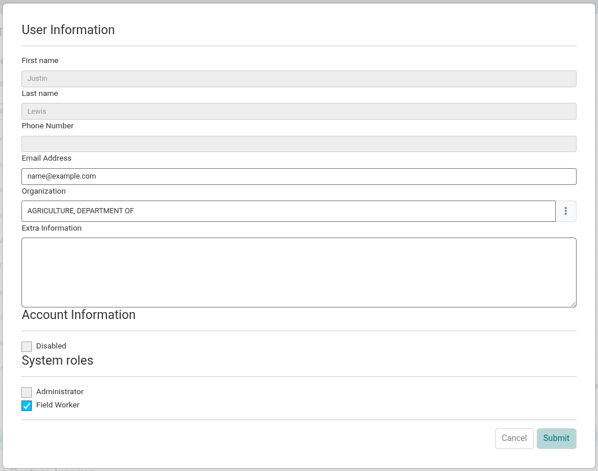

The *Manage Accounts* section of the System Configuration page lists all users in IDM. Use it to add, bulk upload, export, edit, disable, and delete users.

## Accessing the Manage Accounts page

1. Sign in as an Administrator.
2. Open the navigation menu in the upper right hand corner of IDM and choose *System Configuration*.
3. *Manage Accounts* is the first section of the page.

The users table has the columns *Username*, *First name*, *Last name*, *Phone Number*, *Email Address*, and *Organization*. Type in the box under a column header to filter the table. Use the page numbers under the table to see more users.

On deployments that use single sign-on, users added in IDM have their email address as their username. Their first name, last name, and phone number come from the single sign-on system and are updated each time they sign in, so these columns are blank until the user signs in for the first time.

## User Roles

| Role | Description |
|---|---|
| Administrator | Administrators can do all the functions of a Field Worker but also have the ability to administer the configuration of the IDM system. |
| Field Worker | Field Workers are the primary users of IDM. Their primary tasks are to upload data, process data into products, and create metadata. See the [Field Worker Guides](../field-worker/index.md) for more details. |

Roles are set with the checkboxes in the *System roles* section of the add and edit forms. A user can have more than one role. New users have the Field Worker role checked by default.

## Creating A User

On deployments that use single sign-on, a person can only sign in to IDM after an administrator has added them here. IDM matches the email address of the person signing in to the email address of a user in IDM.

1. Click the *Add new User* button under the users table.
2. Fill out the fields and click *Submit*.

| Field | Description |
|---|---|
| Email Address | Required. This MUST match the email address the person uses in the single sign-on system. It can't be the same as the email address of another user. |
| Organization | The organization the user is a part of. This field can be left blank. |
| Extra Information | Any additional information about the user and their involvement in tasks or data related to IDM. |
| System roles | One checkbox for each role. Field Worker is checked by default. |

### Deployments Without Single Sign-On

These options are only available on deployments that don't require single sign-on.

The *Add new User* form also has the fields *First name*, *Last name*, *Phone Number*, *Username*, *Password*, and *Confirm password*. First name, last name, email address, username, and password are required. The password must be at least 14 characters long and contain at least two uppercase letters, two lowercase letters, two digits, and two special characters.

Instead of entering a user's details yourself, you can invite them by email:

1. Click the *Invite User* button above the users table.
2. In the *Invite a User* form, enter the *Email Address*, choose an *Organization*, check the *System roles*, and click *Submit*.
3. IDM emails the person a link to finish creating their account. On that page they enter their name, phone number, email address, username, and password. The link stops working after a set number of hours, which the email states.

Invitations are sent with the server set up in [Email Settings](email-settings.md).

## Exporting Users

Click the *Export Users* button under the users table to download a list of all users. The download is a zip file, `idm-users.zip`, containing one CSV file (currently named `session-event-export.csv`). It has one row per user and these columns:

| Column | Description |
|---|---|
| username | The user's username. |
| firstName | First name. |
| lastName | Last name. |
| organization | The name of the user's organization. |
| email | Email address. |
| phoneNumber | Phone number. |
| oid | The user's internal IDM identifier. |

The export lists organization names, not the organization codes that [Bulk Uploading Users](#bulk-uploading-users) expects, so it can't be uploaded again as is.

## Bulk Uploading Users

Users can be uploaded in bulk with a spreadsheet. Each new user is assigned the organization and role set in the spreadsheet. If the spreadsheet has no *Role* column, every new user is assigned the Field Worker role.

**Spreadsheet Requirements**

1. The spreadsheet must be in CSV format.
2. There must be a header row containing column names.
3. The required columns are First Name, Last Name, Email, and Organization. Role is optional.
4. Column names are not case sensitive and spaces are ignored, but they must otherwise match the names in the table below. For example, `First Name` and `firstname` both work, but `Email Address` is not recognized. Columns with other names are ignored.

1. Click on the *Upload Users* button to open the upload users modal.
2. Drag and drop a .CSV file containing the users to add, or click to select one. The upload starts as soon as the file is selected.

| Column | Required | Description |
|---|---|---|
| First Name | Yes | First name of the user being added. |
| Last Name | Yes | Last name of the user being added. |
| Email | Yes | Email address of the user being added. This MUST match the email being used in the single sign on system that IDM is integrated with. |
| Organization (or Org) | Yes | Organization that the user being added is a part of. This MUST be set to the code of an organization registered in the IDM system. You can find this code in the [Organizations](organizations.md) section of the administration pages of IDM.   |
| Role | No | Set to `admin` to make the user an Administrator.  **Warning:** if the spreadsheet has a Role column, any user whose value is not `admin`, including a blank value, is created with no role. Leave the Role column out entirely to make every user a Field Worker, or set roles afterwards by [editing each user](#editing-a-user). |

:::warning

- Users whose email address already exists in IDM are skipped. Their accounts aren't changed. Email addresses are not case sensitive.
- The upload is all or nothing. If any row has an error, such as an organization code that doesn't exist, no users are added. The error message gives the line number of the problem row. Fix it and upload the whole file again.

:::

## Editing A User

Editing a user allows you to change the fields that are managed by IDM. On deployments that use single sign-on, the fields that come from the single sign-on system are shown in grey and can't be edited.

1. Find the user in the users table in the *Manage Accounts* section.
2. Click the edit button (pencil) on the far right of the row to open the user form.
3. Change the fields and click *Submit*.

| Field | Description |
|---|---|
| First name | First name of the user. On single sign-on deployments it comes from the single sign-on system and can't be edited. |
| Last name | Last name of the user. On single sign-on deployments it comes from the single sign-on system and can't be edited. |
| Phone Number | Phone number of the user. On single sign-on deployments it comes from the single sign-on system and can't be edited. |
| Email Address | Email address of the user. On single sign-on deployments this is how IDM recognizes the user when they sign in, so it MUST match the email address they use in the single sign-on system. |
| Organization | Organization that the user is a part of. This field can be left blank if no applicable organization exists in the list. |
| Extra Information | Any additional information about the user and their involvement in tasks or data related to IDM. |
| Username | Only on deployments that don't require single sign-on. The username of the `admin` user can't be changed. |
| Change password? | Only on deployments that don't require single sign-on. Check it to show the *Password* and *Confirm password* fields and set a new password. |
| Disabled | Check it to deactivate the user. A disabled user can't sign in. It is not shown for the `admin` user. |
| System roles | One checkbox for each role. Check every role the user should have. |

## Deactivating A User

To stop a user from signing in without removing them from IDM, [edit the user](#editing-a-user), check *Disabled*, and click *Submit*. Uncheck it to let them sign in again. The `admin` user can't be disabled.

## Deleting A User

1. Find the user in the users table in the *Manage Accounts* section.
2. Click the delete button (trash can) on the far right of the row.
3. Click *Delete* to confirm.

Deleting a user can't be undone. To keep the user's record, [deactivate](#deactivating-a-user) them instead. The `admin` user can't be deleted.
