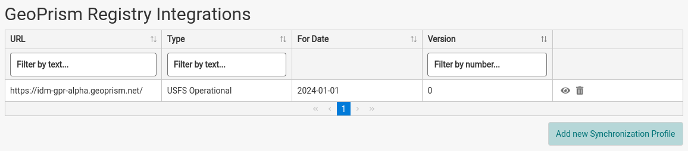
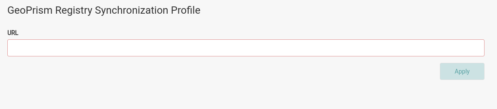
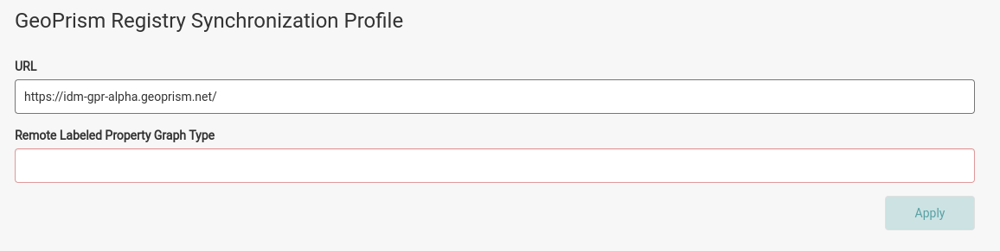
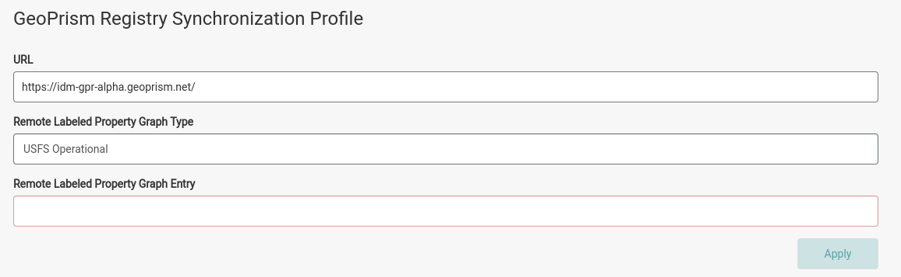
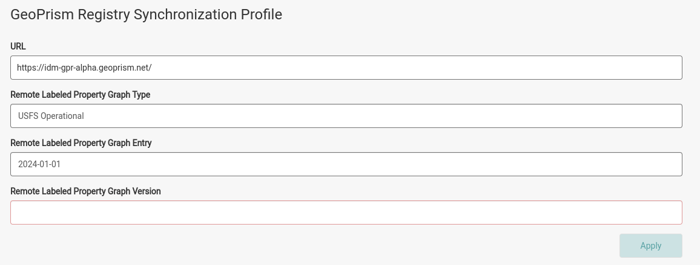
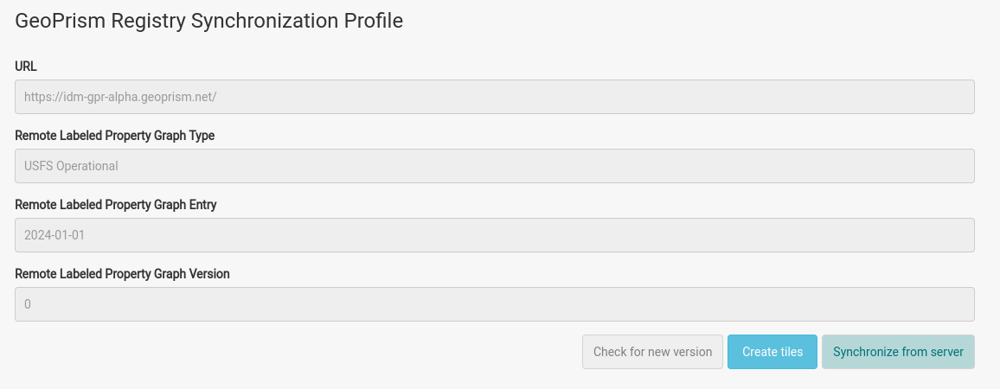

Custom hierarchies are synchronized from an instance of GeoPrism Registry. When imported to IDM they enable the ability to filter the map data in the Site Viewer by the geographies that are imported.

## View the List of Synchronization Profiles

Synchronization profiles are listed in the *GeoPrism Registry Integrations* section of the *System Configuration* page. The table has the columns *URL*, *Type*, *For Date* and *Version*. Each row has an eye icon to open the profile and a trash icon to delete it.

## Register a GeoPrism Registry Integration

:::info

Synchronization profiles must connect to an instance of GeoPrism Registry that contains a hierarchy of geographies you would like to import to IDM.

:::

1. From the *System Configuration* page, scroll down to the *GeoPrism Registry Integrations* section.
2. Click the *Add new Synchronization Profile* button to open the screen for creating a new profile.

   
3. Enter the *URL* of an instance of GeoPrism Registry containing the geographic hierarchy you’d like to import. IDM connects to that instance when you leave the *URL* field (for example, by pressing Tab or clicking elsewhere). The URL must start with `http://` or `https://`. If IDM can't reach the server, an error message is shown.
4. If successfully connected, the *Remote Labeled Property Graph Type* field appears. Select the graph containing the data to import.

   
5. After selecting the type, the *Remote Labeled Property Graph Entry* field appears. Select the date of the graph.

   
6. After selecting the entry, the *Remote Labeled Property Graph Version* field appears. Select the version of the graph.

   
7. Push the *Apply* button. *Apply* stays disabled until all fields are filled out.

After a profile is created, its fields are read-only. To use a different server or graph, delete the profile and create a new one. To move to a newer version of the same graph, use *Check for new version* (see below).

## Synchronize Geographic Hierarchies From an Existing Synchronization Profile

1. Open an existing synchronization profile by clicking its eye icon.
2. Push the *Synchronize from server* button. A progress indicator is shown while the synchronization runs.

   

The profile screen also has these buttons:

- *Check for new version*: checks the GeoPrism Registry server for a newer version of the same graph entry. If one is found, IDM asks whether to upgrade to it. Pushing *Upgrade* switches the profile to the newest version and synchronizes it from the server. This action can't be undone. If there is no newer version, IDM shows "No newer versions were found."
- *Create tiles*: generates the map tiles for the synchronized geographies.

## Delete a Synchronization Profile

1. Click the trash icon for the profile in the *GeoPrism Registry Integrations* table.
2. Push *Delete* to confirm.
