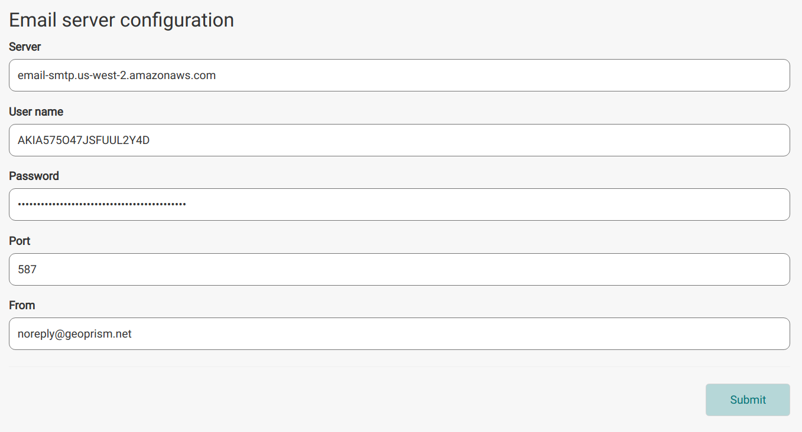

The email settings allow administrators to configure the connection properties for the email server used by IDM. To open them, choose *System Configuration* from the navigation menu, and click *Configure Email* in the *System Email* section. All fields are required. Emails are sent to users of the system to notify of important events. For example, an email is sent to a Field Worker once an upload has successfully finished.

| Field | Description |
|---|---|
| Server | URL for the email server. |
| User name | User name used to authenticate with the email server. |
| Password | Password used to authenticate with the email server. |
| Port | Server port used to connect to the email server. |
| From | Email address used as the from address when messages are sent. |
