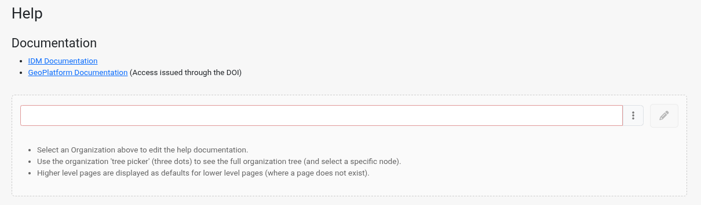
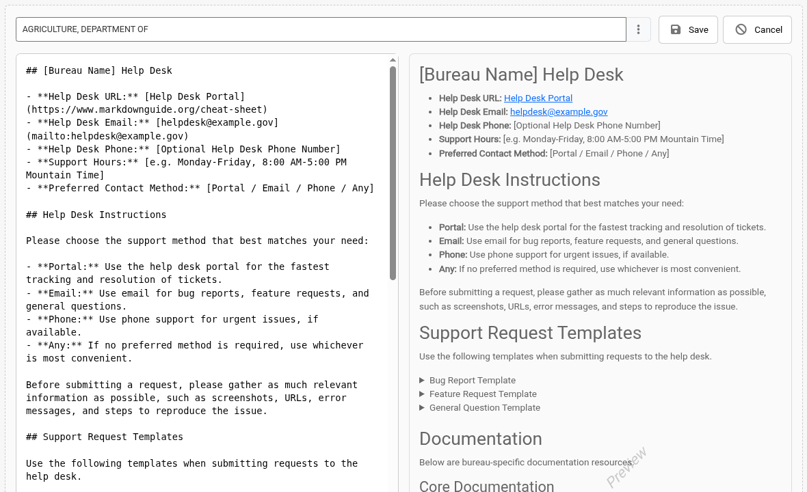

Administrators can write a help page for each organization. When users click *Need some help?* in the IDM header, they see the help page for their organization. This should be the first place users go for support, so use it to tell them how to reach your organization's help desk. See [Getting Help](../getting-started/getting-help.md) for what users see.

## Which Page Users See

Users see the help page for the organization assigned to their [account](accounts.md). If that organization doesn't have a help page, IDM shows the page of a higher-level organization in the [organization hierarchy](organizations.md). A help page written for a parent organization therefore acts as the default for all organizations below it that don't have their own.

## Editing a Help Page

1. Click *Need some help?* in the header at the top of any IDM page. The help page opens in a new browser tab.
2. Select the organization whose help page you want to edit in the organization field at the top of the page. Start typing to search, or click the tree picker (three dots) to browse the full organization tree and select a specific organization.

   
3. Click the edit (pencil) button. If the organization doesn't have a help page yet, the editor opens with a template you can fill in.
4. Write the page in Markdown in the editor. A preview of the page is shown next to the editor as you type.

   
5. Click *Save* to publish the page, or *Cancel* to discard your changes.

## The Help Page Template

The template has sections for:

- your organization's help desk contacts: portal URL, email, phone, support hours and preferred contact method
- instructions on which contact method to use
- templates users can copy for bug reports, feature requests and general questions
- organization-specific documentation and training resources
- other notes, such as policies or escalation guidance

Replace the placeholder text in brackets with your organization's details, and remove any sections you don't need.

:::tip

Tell users when to escalate to the IDM help desk at [support@terraframe.com](mailto:support@terraframe.com), which provides general IDM support when organization support isn't adequate. See [Getting Help](../getting-started/getting-help.md).

:::
