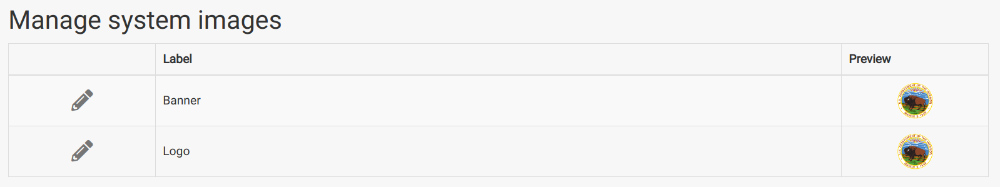
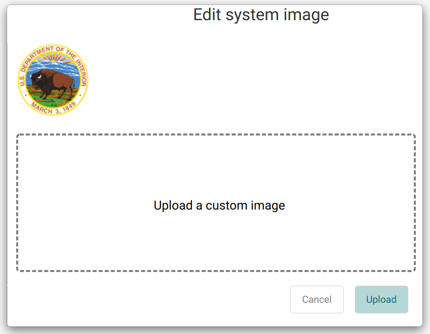

The *Manage System Images* section of the System Configuration page allows administrators to configure the images used for the logo in the header of IDM.

## Change The IDM Logo

The logo can be changed by Administrators.

1. Choose *System Configuration* from the navigation menu, and find the *Manage System Images* section.
2. Click the edit button at the left of the icons table to open a modal.
3. Select an image file and click submit.

