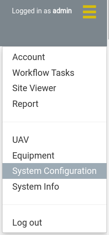
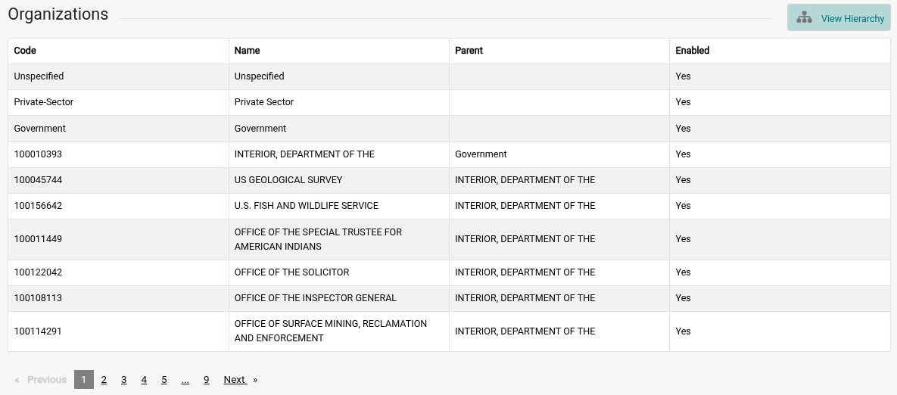
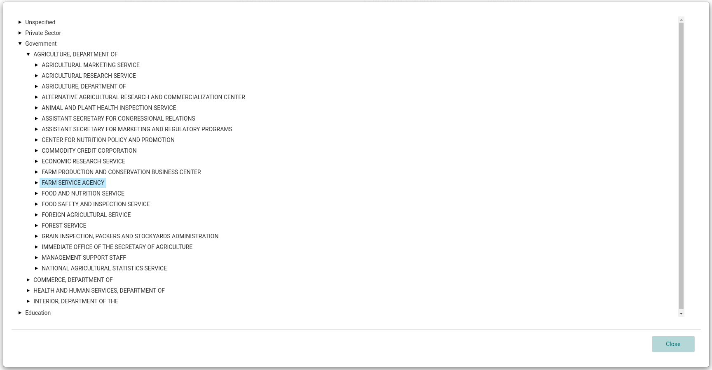
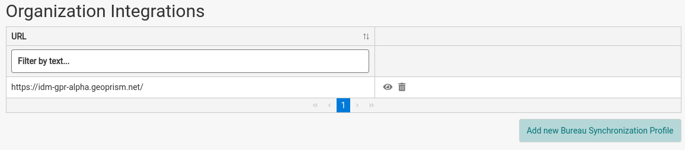
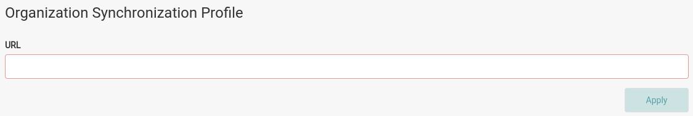
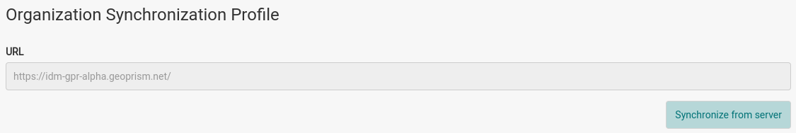

Organizations are pulled from [SAM.gov](https://sam.gov) into an instance of GeoPrism Registry that’s managed for IDM. IDM then pulls those from GeoPrism Registry through a formal synchronization widget in IDM.

## View the List of Organizations

1. Navigate to the *System Configuration* page from the navigation menu.

   
2. All organizations currently registered in IDM are listed in the *Organizations* section of the *System Configuration* page. The table has the columns *Code*, *Name*, *Parent* and *Enabled*.

:::info

The code is the formal ID of the organization from the [SAM.gov](https://sam.gov) database.

:::

The table shows 10 organizations at a time. Use the page controls below the table to see the rest.

To view the organizations as a hierarchy, click the *View Hierarchy* button on the upper right of the *Organizations* section. Expand an organization to see its children, and push *Close* when done.

Organizations are assigned to [sites](../field-worker/organizing-data/sites.md), [accounts](accounts.md) and [UAVs](uav-registration.md). They don't control who can see private sites or collections.

## Register an Organization Synchronization

:::info

Organization synchronizations must connect to an instance of GeoPrism Registry that contains a hierarchy of organizations.

:::

Organization synchronization profiles are listed in the *Organization Integrations* section of the *System Configuration* page. The table shows the *URL* of each profile.

1. Click the *Add new Bureau Synchronization Profile* button to open the screen for creating a new profile.

   
2. Enter the *URL* of the GeoPrism Registry instance and push *Apply*.

   

Once a profile is created, its URL can't be changed. To use a different URL, delete the profile and create a new one.

## Synchronize Organizations From an Existing Synchronization Profile

1. Open an existing synchronization profile by clicking its eye icon in the *Organization Integrations* table.
2. Push the *Synchronize from server* button. When the synchronization is done, IDM shows the message "Finished synchronizing with the remote server."

   

## Delete a Synchronization Profile

1. Click the trash icon for the profile in the *Organization Integrations* table.
2. Push *Delete* to confirm.
