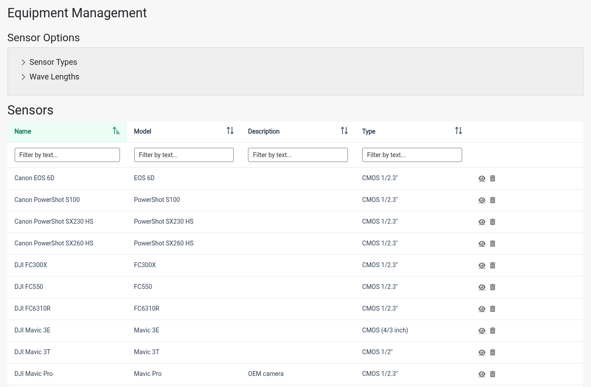
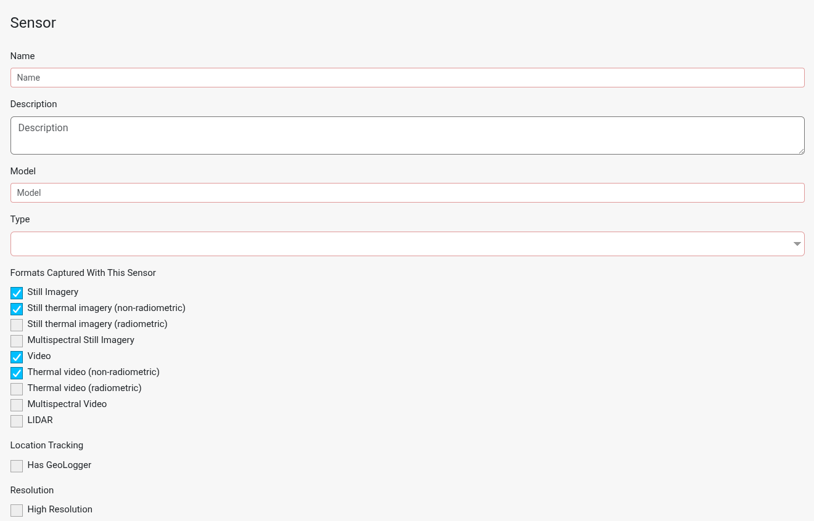
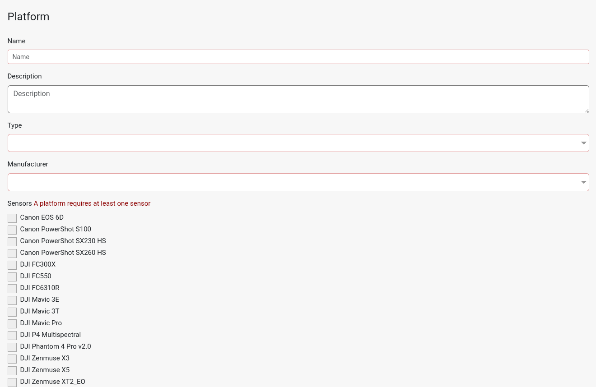

IDM enables Administrators to register the platforms and sensors that are most commonly used by Field Workers. Registered platforms and sensors are available in configuration forms when creating collections. Selecting registered equipment enables automation of portions of collection metadata.

Platforms and sensors are also used when [registering UAVs](uav-registration.md).

## The Equipment Page

Platforms and sensors are managed on the *Equipment* page. Open it by choosing *Equipment* from the navigation menu. Only Administrators can see this menu item.

The page has four sections, from top to bottom:

1. **Sensor Options**: the lists of [Sensor Types and Wave Lengths](#sensor-and-platform-options) that sensors are built from.
2. **Sensors**: the table of registered [sensors](#sensors).
3. **Platform Options**: the lists of [Platform Types and Platform Manufacturers](#sensor-and-platform-options) that platforms are built from.
4. **Platforms**: the table of registered [platforms](#platforms).

A platform must have at least one sensor, so register sensors before the platforms that carry them.

## Sensor and Platform Options

The *Sensor Options* and *Platform Options* sections hold the lists of values offered in the sensor and platform forms:

| List | Used for |
|---|---|
| Sensor Types | The *Type* field on a sensor (for example, Multispectral). |
| Wave Lengths | The *Wave Length* checkboxes on a sensor. |
| Platform Types | The *Type* field on a platform (for example, fixed wing). |
| Platform Manufacturer | The *Manufacturer* field on a platform. |

Click a list's heading to expand or collapse it. Each list is a table of names:

- To add a value, click the *Add new …* button below the table, enter a *Name*, and click *Apply*.
- To view or edit a value, click the view icon in its row. Click *Edit*, change the name, and click *Apply*.
- To remove a value, click the remove icon in its row and confirm.

A sensor type, platform type or platform manufacturer can't be removed while a sensor or platform uses it.

## Sensors

The *Sensors* table lists every registered sensor with its Name, Model, Description and Type.

### Adding a Sensor

1. On the Equipment page, click *Add new Sensor* below the Sensors table.
2. Fill out the sensor form.

   
3. Click *Apply*.

To change a sensor, click the view icon in its row, then click *Edit*. To remove a sensor, click the remove icon in its row and confirm.

### Sensor Fields

| Field | Required | Description |
|---|---|---|
| Name | Yes | Name of the sensor (example: Anafi). |
| Description | No | Description of the sensor. |
| Model | Yes | Model of the sensor (example: Micasense Altum (w/o thermal) 2064x1544 (R,G,B,RE, NIR) 7.1 [mm] x 5.3 [mm] FL 8). |
| Type | Yes | Type of sensor, chosen from the [Sensor Types](#sensor-and-platform-options) list (example: Multispectral). |
| Formats Captured With This Sensor | At least one | The kinds of data this sensor captures. When a Field Worker creates a collection with this sensor, only these formats are offered as the collection's format. A new sensor starts with Still Imagery, Still thermal imagery (non-radiometric), Video and Thermal video (non-radiometric) checked; uncheck any the sensor doesn't capture. The options are: - Still Imagery - Still thermal imagery (non-radiometric) - Still thermal imagery (radiometric) - Multispectral Still Imagery - Video - Thermal video (non-radiometric) - Thermal video (radiometric) - Multispectral Video - LIDAR |
| Has GeoLogger | No | Check this if the sensor writes image locations to a separate geo location (geologger) file instead of the images' EXIF headers. Collections using this sensor must have a [geo location file](../field-worker/products/geologger.md) uploaded before they can be processed. |
| High Resolution | No | Check this for high resolution sensors. When processing a collection that uses this sensor, IDM defaults to a finer resolution (2 cm instead of 5 cm) and higher point cloud quality. |
| Pixel Size Width | Yes | Pixel size width of the sensor. Recorded in collection metadata. |
| Pixel Size Height | Yes | Pixel size height of the sensor. Recorded in collection metadata. |
| Sensor Width | Yes | Width of the sensor, in millimeters. |
| Sensor Height | Yes | Height of the sensor, in millimeters. |
| Focal Length | Yes | Focal length of the sensor, in millimeters. |
| Wave Length | At least one | The wave lengths the sensor captures, chosen from the [Wave Lengths](#sensor-and-platform-options) list. |

When you view a sensor, a *Used on Platforms* list shows the platforms that carry it.

## Platforms

The *Platforms* table lists every registered platform with its Name and Description.

### Adding a Platform

1. On the Equipment page, click *Add new Platform* below the Platforms table.
2. Fill out the platform form.

   
3. Click *Apply*.

To change a platform, click the view icon in its row, then click *Edit*. To remove a platform, click the remove icon in its row and confirm. A platform can't be removed while a [UAV](uav-registration.md) uses it.

### Platform Fields

| Field | Required | Description |
|---|---|---|
| Name | Yes | Name of the platform (example: Parrot Anafi). |
| Description | No | Description of the platform. |
| Type | Yes | Type of platform, chosen from the [Platform Types](#sensor-and-platform-options) list (example: fixed wing). |
| Manufacturer | Yes | Manufacturer of the platform, chosen from the [Platform Manufacturer](#sensor-and-platform-options) list. |
| Sensors | At least one | The registered sensors this platform can carry. |
