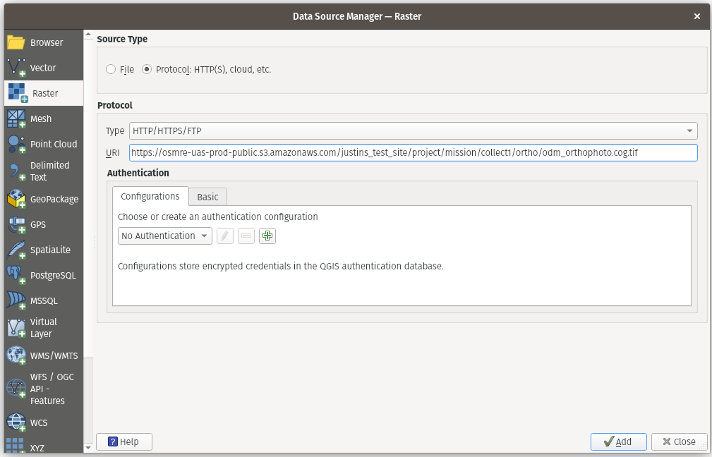
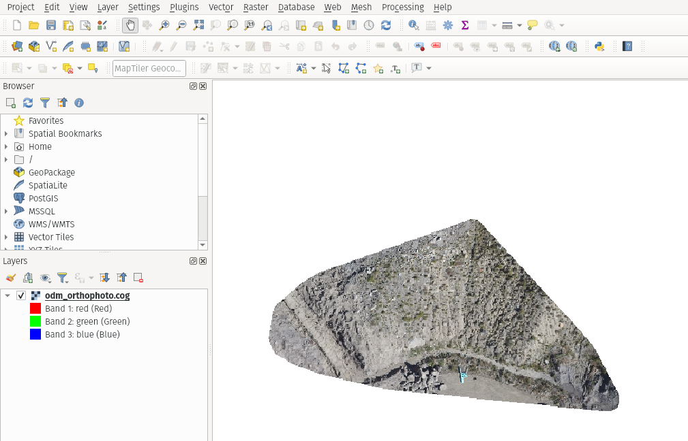

IDM hosts all published image mosaic and elevation products in the public SpatioTemporal Asset Catalog (STAC), [Know-STAC](../know-stac.md), making these products available as Cloud Optimized GeoTIFFs (COG). This means that all published COGs are available from standard COG API functionality. See [Cloud Native Formats](../getting-started/cloud-native-formats.md) for why IDM uses COGs.

## Finding the URL of a Published COG

The most reliable way to get a COG's URL is from the product's STAC item, which lists the public URL of each of the product's files.

1. Find the published product in the *Products* tab of the Site Viewer sidebar, and select *Share*. See [Sharing a Published Product](../field-worker/publishing-products.md#sharing-a-published-product).
2. Open the *STAC* link. It opens the product's STAC item, a JSON file.
3. In the item's `assets`, find the file you want and copy its `href`:
   - The ortho mosaic is the asset with the title `Ortho`.
   - Elevation files (DSM, DTM) have the title `Elevation`.
   - The COG version of each file has the type `image/tiff; application=geotiff; profile=cloud-optimized`, and its file name ends in `.cog.tif`.

   {/* TODO: screenshot of a published product's STAC item JSON, with the href of the Ortho COG asset highlighted. */}

### How COG URLs Are Built

Every published file is at a URL with this pattern:

<code><Deployment value="publicBucketUrl" plain />/&lt;site&gt;/&lt;project&gt;/&lt;mission&gt;/&lt;collection&gt;/products/&lt;product name&gt;/&lt;file path&gt;</code>

For example:

<code><Deployment value="publicBucketUrl" plain />/justins_test_site/project/mission/flooddamagetest/products/1728194256657/ortho/odm_orthophoto.cog.tif</code>

- <code><Deployment value="publicBucketUrl" plain /></code> is the public bucket of the <Deployment value="name" /> installation. Each installation of IDM publishes to its own bucket.
- `justins_test_site/project/mission/flooddamagetest` is the path to the collection, starting at the site.
- `products/1728194256657` is the product group. Each processing run or [uploaded product](../field-worker/products/uploading-products.md#product-groups) creates its own group, so this part is different for every product.
- `ortho/odm_orthophoto.cog.tif` is the file within the product group.

The file path depends on how the product was made. For example, an ortho mosaic produced by IDM processing is at `ortho/odm_orthophoto.cog.tif`, but elevation files and uploaded products use other paths and file names. Use the STAC item to get the exact URL rather than guessing the file path.

<DeploymentNote value="publicBucketUrl" />

## Adding a Published COG to Quantum GIS (QGIS)

Add a raster data source in QGIS and configure it to use the COG URL from the STAC item.

Once added the COG is available for streaming directly from the image on s3.

