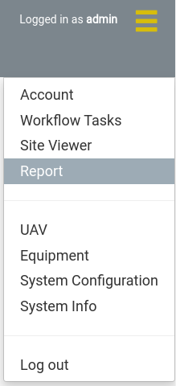
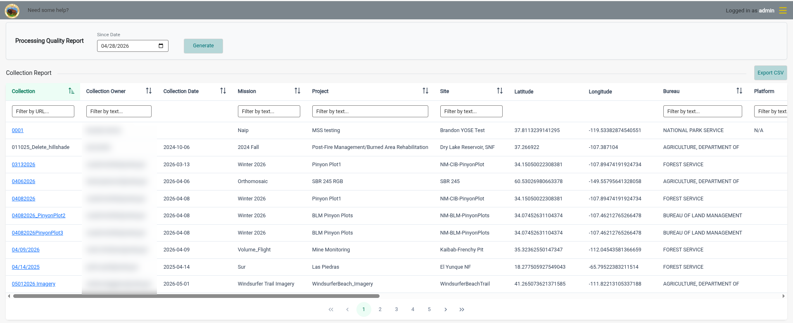
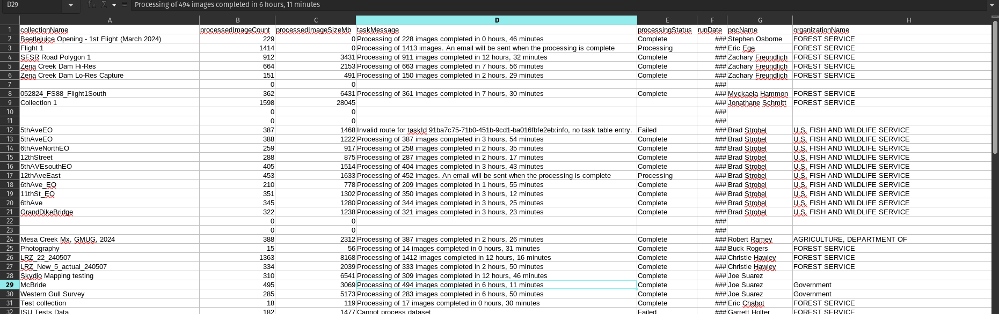
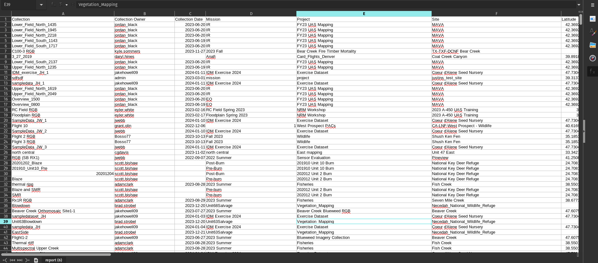

## View Usage Reports

1. Navigate to the *Report* page using the navigation menu. The *Report* menu item is available to all users.

   
2. The report page has two reports:
   - The *Processing Quality Report* is a CSV file with information about each processing run in the system. It is only shown to Administrators.
   - The *Collection Report* is a table with information about every collection in the system. It is shown to all users.

### Generate a Processing Quality Report

The *Processing Quality Report* bar at the top of the page generates a report on the processing runs in the system. This is where you can see information for each time a processing job is run.

1. Choose a *Since Date*. The report includes the runs started on or after this date. It defaults to six months before today. Clear the date to include all runs.
2. Push the *Generate* button. The report is downloaded as `report.csv`.

   

The report lists the most recent runs first, up to 10,000 runs. It has these columns:

| Column | Description |
|---|---|
| collectionName | Name of the collection that was processed. |
| processedImageCount | Number of images used in the run. |
| processedImageSizeMb | Total size of those images, in megabytes. |
| taskMessage | The latest message of the processing task. |
| processingStatus | The status of the processing task, such as Complete, Processing, or Failed. |
| runDate | The date the run started (YYYY-MM-DD). |
| pocName | The point of contact name of the collection. |
| organizationName | The organization of the collection's site. |
| s3Path | Where the collection is stored. |
| uavSerial | Serial number of the collection's UAV. |
| uavFAA | FAA number of the collection's UAV. |
| sensorName | Name of the collection's sensor. |
| sensorType | Type of the collection's sensor. |
| featureQuality | The feature quality processing option. |
| radiometricCalibration | The radiometric calibration processing option. |
| odmConfig | All the processing options of the run. |
| instanceType | The type of server the run was processed on. |
| runtime (seconds) | How long the run took, in seconds. Blank if the run hasn't finished. |

### View the Collection Report

The *Collection Report* provides a report on all collections in the system, including collections that have been deleted. This is where you can see information about the sensors, platforms, data size, and other information that could be useful to understand the characteristics of each collection.

1. View the report in the table. Click a column header to sort by it, and use the boxes under the headers to filter the rows. Use the page numbers under the table to see more rows.
2. (optional) Export the report as a CSV file (`report.csv`) using the *Export CSV* button above the table. The export always contains every row of the report. It doesn't apply the filters or sorting from the table.

   

| Column | Description |
|---|---|
| Collection | Name of the collection. Click it to open the collection in the Site Viewer. It isn't a link if the collection no longer exists. |
| Collection Owner | Username of the user who owns the collection. |
| Collection Date | Date the data was collected. |
| Mission | Name of the collection's mission. |
| Project | Name of the collection's project. |
| Site | Name of the collection's site. |
| Latitude | Latitude of the site, in decimal degrees. |
| Longitude | Longitude of the site, in decimal degrees. |
| Bureau | Organization of the collection's site. |
| Platform | Name of the collection's platform. |
| Sensor | Name of the collection's sensor. |
| FAA Id Number | FAA ID number of the collection's UAV. |
| Serial Number | Serial number of the collection's UAV. |
| RAW Images Count | Number of files in the collection's raw folder. |
| EROS Metadata Complete | Whether the collection's metadata has been submitted. |
| Video | Whether the collection contains video. |
| Storage size | Total size of all the collection's files, in bytes. |
| Number of Downloads | Number of times the collection's imagery has been opened as a map layer. File downloads are not counted. |
| Number of Products | Number of products for the collection. |
| Date of Create | Date the collection was created in IDM. In the CSV export this column is named *Date of Creation*. |
| Date of Delete | Date the collection was deleted from IDM. Blank if it hasn't been deleted. |

Text columns are filtered by any part of the value, and *RAW Images Count* by an exact number. *EROS Metadata Complete* and *Video* are filtered by choosing *True* or *False*. The other columns can't be filtered.
