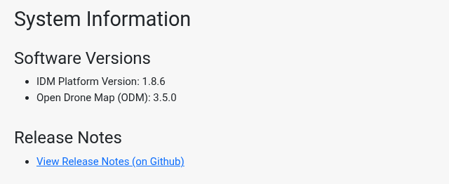

The System Information page shows which release of IDM is running. It is updated automatically with each release.

To open it, choose *System Info* from the navigation menu. Only Administrators see this menu item, but any signed-in user can open the page directly at <Deployment value="appUrl" path="#/admin/system-info" />.

The page shows:

- **Software Versions**: the IDM Platform Version and the Open Drone Map (ODM) version used for processing.
- **Release Notes**: a link to the IDM release notes on GitHub, which list the features and fixes in each release.

Include the IDM version when you [contact IDM support](../getting-started/getting-help.md) about a problem.
