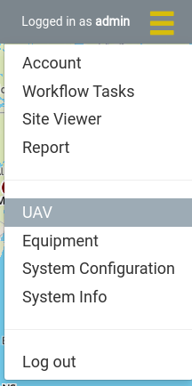
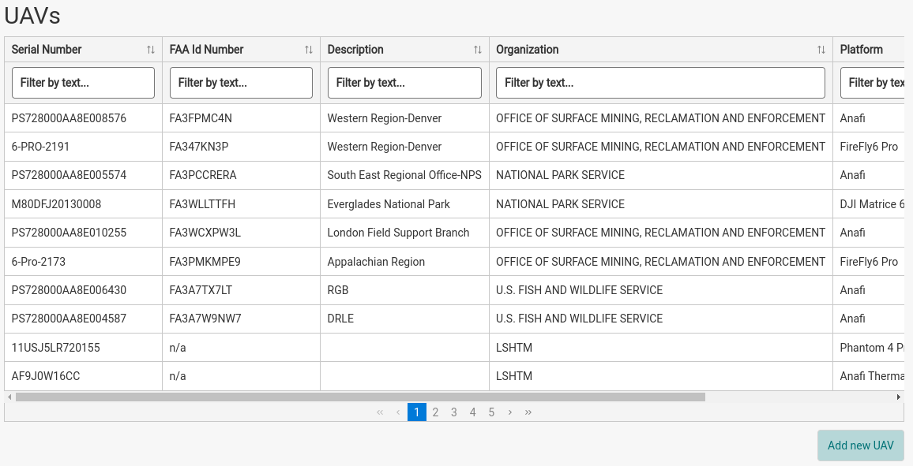
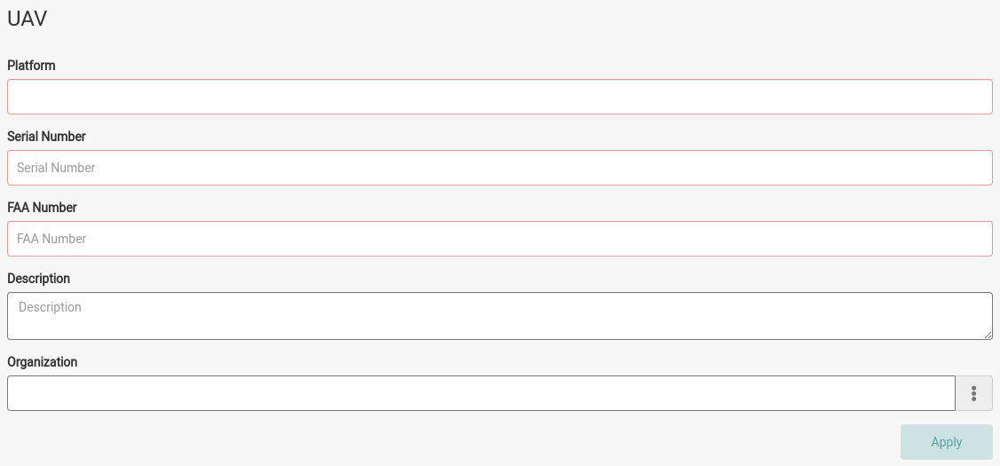
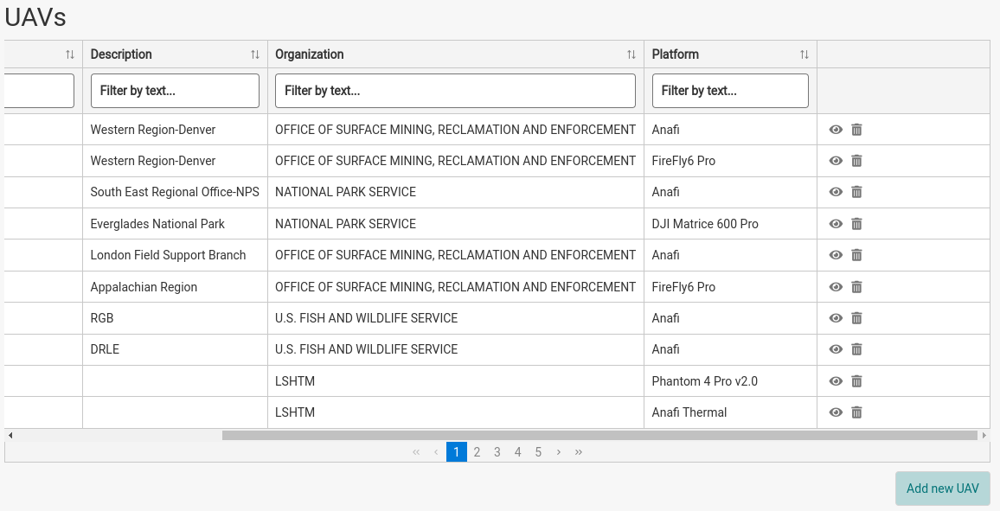
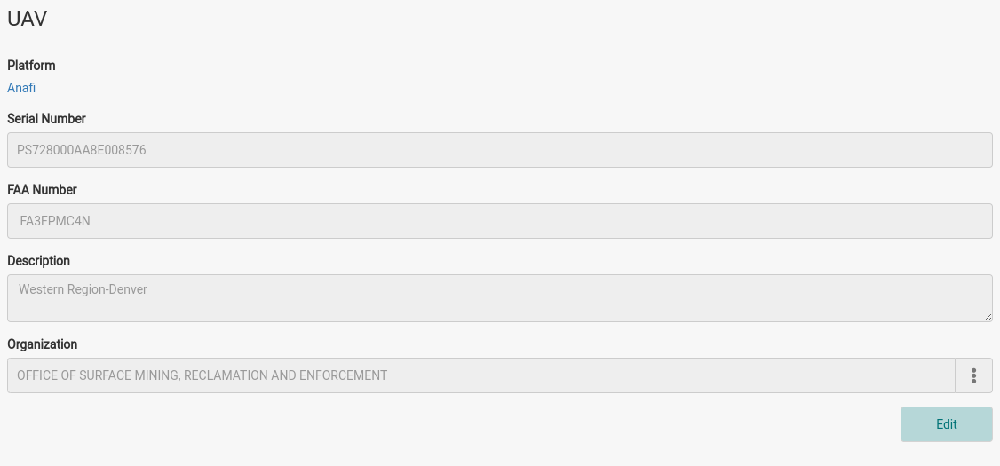
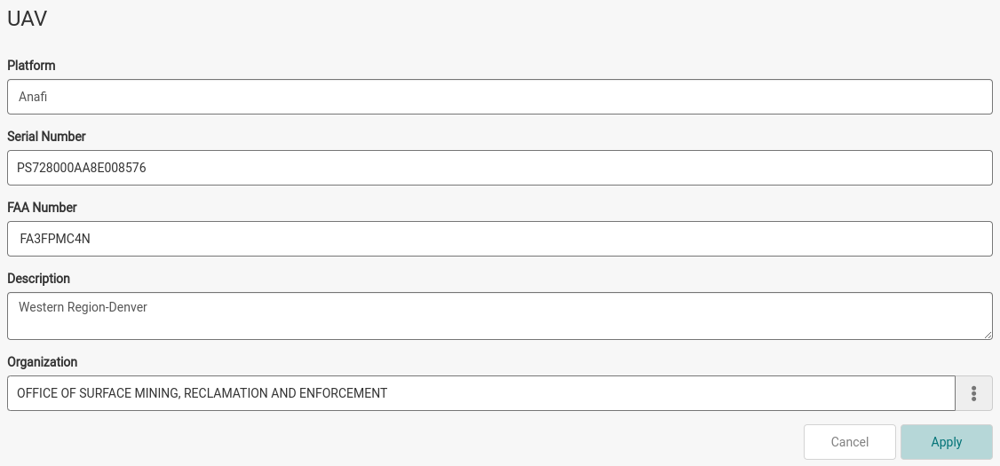

The UAV registration page allows for the registration and management of UAVs in IDM. Only Administrators can register, edit or remove UAVs.

:::info

If the sensor and/or platform doesn’t exist for the UAV you’re registering please see the [Platforms and Sensors](platforms-and-sensors.md) page.

:::

## Registering a UAV

1. Navigate to the UAV page by choosing *UAV* from the navigation menu.

   
2. The table lists all the UAVs currently registered in the system, with their Serial Number, FAA Id Number, Description, Organization and Platform. Click the *Add new UAV* button.

   
3. Fill out the form. All fields except *Description* are required. The *Apply* button stays disabled until they are filled in.

   
4. Click *Apply*.

:::info

If you do not have a serial number or FAA number but must still register the UAV, enter “n/a” instead.

:::

| Field | Required | Description |
|---|---|---|
| Platform | Yes | Platform of the UAV, chosen from the registered [platforms](platforms-and-sensors.md#platforms). |
| Serial Number | Yes | Serial number of the UAV. |
| FAA Number | Yes | FAA number of the UAV. Up to 10 characters. |
| Description | No | Description of the UAV or any information that might be useful to know about this registration. |
| Organization | Yes | Organization that the UAV belongs to. Start typing in the field to search for the organization, then select it from the list. |

## Edit a UAV Registration

1. Scroll to the right of the registered UAV table and click the eye icon for the UAV you would like to edit.

   
2. Click the *Edit* button on the UAV form.

   
3. Change any values and click *Apply*.

   

## Remove a UAV Registration

1. Scroll to the right of the registered UAV table and click the remove icon for the UAV you would like to remove.
2. Confirm that you want to remove the UAV.

A UAV can't be removed while a collection uses it.
