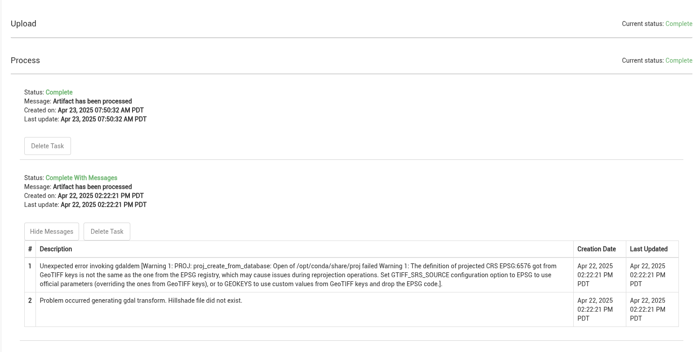
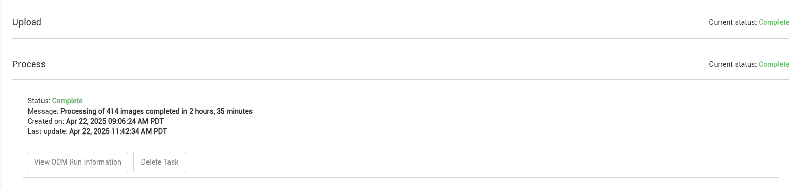
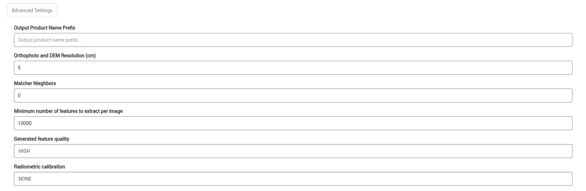
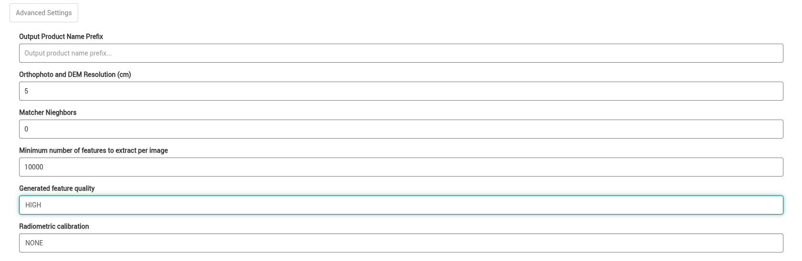

## Data Upload

### What does the error “The zip did not contain any files to process” mean and how can I fix it?

The full error is:

> *The zip did not contain any files to process. Files must follow proper naming conventions and end in one of the following file extensions: jpg, jpeg, png*

The list of extensions in the message depends on the collection's format. For multispectral and radiometric collections, the message starts with "You selected a multispectral sensor." or "You selected a radiometric sensor."

This error means that none of the files in the archive have a file type the collection accepts. Common causes are:

- The files don't match the collection's format. For example, .jpg images were uploaded to a multispectral collection, which only accepts .tif files.
- The archive only contains other files, such as a geo location or ground control point file, but the matching *Upload includes…* option wasn't checked.

Check the file types in your archive against the [supported file formats](field-worker/uploading-data/index.md#supported-file-formats) for the collection's format. See the [file requirements](field-worker/uploading-data/index.md#file-requirements) for uploads.

### My upload appears to be processing indefinitely. How can I find out if there are any error messages?

All error messages for processing tasks that are accessible from IDM are found by expanding the processing task on the [Workflow Tasks](field-worker/workflow-tasks.md) page. See [Troubleshooting Processing Errors](field-worker/troubleshooting-processing-errors.md) for what each error means and how to fix it.

In cases where the log output from Open Drone Map (ODM) is able to be captured the full ODM log will be available in the processing task by pushing the “View ODM Run Information” button.

### I started processing a dataset a couple weeks ago and it shows that it is still processing. How can I terminate it or restart it?

There is no way to terminate a running processing task. If a step stops reporting progress, IDM fails it with the message "The task timed out (was processing for too long with no updates)." This happens after 1 day without updates for ODM processing, 3 days for storing ODM results, and 7 days for most other steps. See [Timeouts and Interrupted Jobs](field-worker/troubleshooting-processing-errors.md#timeouts-and-interrupted-jobs). If your task still shows as processing after that, please [contact IDM support](getting-started/getting-help.md) to report your issue.

### The FAA ID field isn’t auto-populating with my aircraft when I begin typing in the values. How can I get IDM to recognize my aircraft?

If the UAV you are searching for is not appearing in the search drop down the aircraft may not be registered yet. All UAVs must be [registered in IDM](administration/uav-registration.md) before becoming available in the system. Please [contact IDM support](getting-started/getting-help.md) to register the UAV.

### I can’t find my camera or platform when creating a collection. How can I get them added to IDM?

Sensors and platforms options are registered with IDM by an IDM administrator (see [Platforms and Sensors](administration/platforms-and-sensors.md)). Please [contact IDM support](getting-started/getting-help.md) to request either be registered or changed.

### When creating a new collection, do I need to enter information into all of the fields or just certain ones?

Only required fields must be filled out. Many of the required fields are automated based on the UAV, sensor, and platform set on the collection while all others are highlighted in red. Other metadata fields are encouraged to be filled out when accurate information is known. See the [collection fields](field-worker/organizing-data/collections.md#collection-fields).

## Processing

### The orthomosaic created by IDM lacks the detail of my original images. Why is this and how can I improve my orthomosaics?

If your orthomosaic is a coarser resolution than the original it is likely because the processing settings are set to a coarser resolution than the raw data. When configuring a processing task, find the “Orthophoto and DEM Resolution (cm)” option under “Advanced Settings” in the processing options modal. Alter the resolution settings to match the resolution of the raw data. See [Advanced Settings](field-worker/products/generating-products.md#advanced-settings).

### Many of my uploads show warnings next to “Store” in Workflow Tasks. Should I be concerned or is there something I can do to fix this?

Warnings are indication of the system notifying you that the information may be useful for you to know but that the information is not critical. Warnings can generally be ignored but if you have questions please [contact IDM support](getting-started/getting-help.md).

### My collection failed to process with the message “ODM ran out of memory during processing.” What can I do to avoid this issue?

In general the imagery processing task that uses Open Drone Map (ODM) may run out of memory when the raw collection is very large, the individual raw images are large, the images are challenging for ODM to stitch together, and/or the processing quality is set high. Adjusting the advanced settings before running the processing task may be useful in these situations. Try adjusting the “Generated feature quality” option and evaluate the resulting product.

If adjusting the advanced settings does not work for your needs please [contact IDM support](getting-started/getting-help.md) to request evaluation of your situation.
