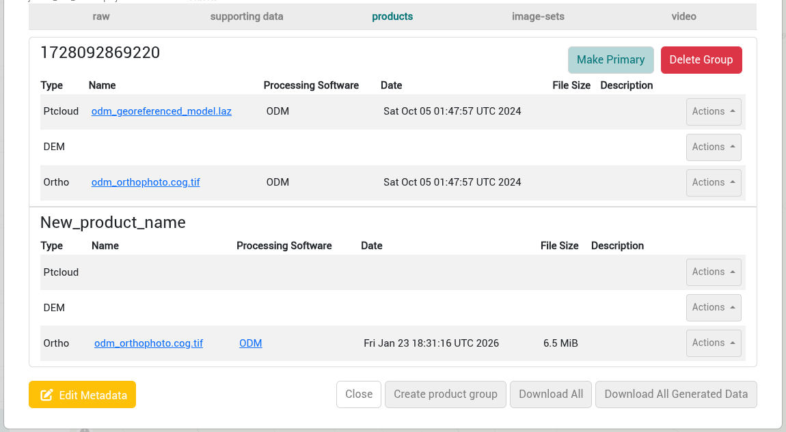

There are multiple places that files can be downloaded depending on what you’re viewing in IDM and what needs to be downloaded.

## Downloading a Single Raw Image

1. Open a collection with the *raw* tab selected.
2. Right click on a raw image and select *Download image*.

## Downloading All Raw Images

The *Download All* button at the bottom of the collection modal downloads the files of the tab that is currently selected.

1. Open a collection with the *raw* tab selected.
2. Click on the *Download All* button at the bottom of the modal.

The raw images of the collection are downloaded as a single zip file. For LiDAR collections, the zip file contains the raw point cloud files.

## Downloading Supporting Data

The *supporting data* tab lists the files that were uploaded with the raw images but are not images, such as a `geo.txt` file.

1. Open a collection and click on the *supporting data* tab.
2. Click the *Download* button next to the file you want.

To download all supporting data files as a single zip file, click the *Download All* button at the bottom of the modal while the *supporting data* tab is selected.

## Downloading Individual Products

The *products* tab of a collection displays the names of the products as hyperlinks to allow downloading individual files.

1. Open a collection and click on the *products* tab.
2. Click on the name of any product in any product group.

## Downloading a Processing Report

If a product row has a report, it can be downloaded from that row's *Actions* menu.

1. Open a collection and click on the *products* tab.
2. Click the *Actions* button on the product row.
3. Click *Download report*.

The *Download report* option only appears when a report exists for that product.

## Downloading All Product Files From The Primary Product Group

Product files can be downloaded from a collection. The download includes files that can be used in other software packages outside of IDM if more specific processing and analysis is needed.

1. Open a collection and click on the *products* tab.
2. Click on the *Download All* button at the bottom of the modal.

   

:::info

The Download All feature downloads the products from the primary product group only.

:::

The products are downloaded as a single zip file. Within the zip file, the products keep their subfolders (for example `ortho`, `dem` and `ptcloud`), so files with the same name, such as `report.pdf`, do not overwrite each other.

## Downloading Product Files and All Processing Files

The product creation process creates the products displayed in the product groups as well as files used in the product creation process. This includes the raster products, log files, and some vector files. Most of these files are not needed but they can be helpful in some situations (e.g. reading log files).

1. Open a collection and click on the *products* tab.
2. Click on the *Download All Generated Data* button at the bottom of the modal.

   

The *Download All Generated Data* button only appears when Open Drone Map produced an `all.zip` file when it processed the collection. It downloads the `all.zip` file of the primary product group.
