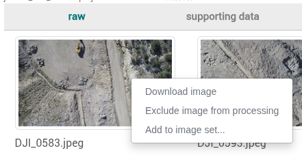
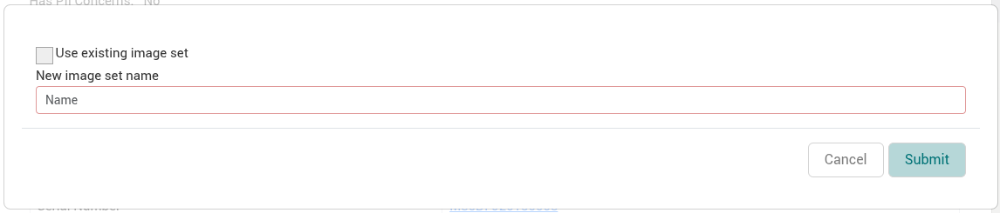
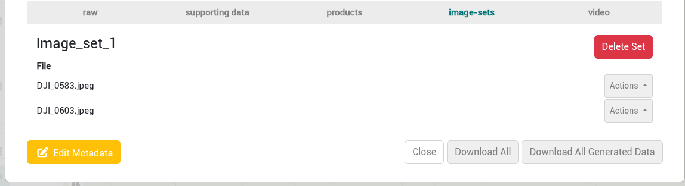
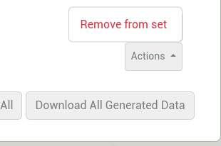
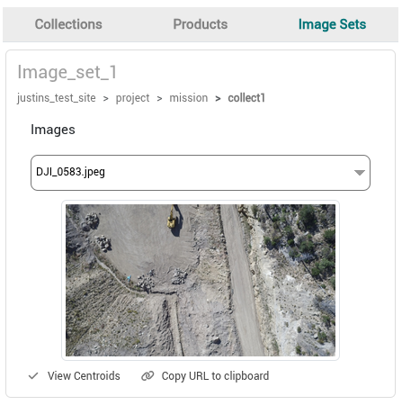
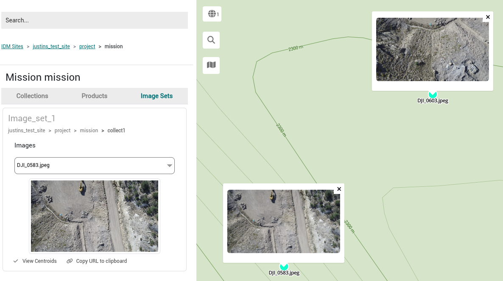

Image sets are groupings of raw images from the raw tab of a collection that are created to share sets of raw images. They make it easier to highlight selections of raw images that show something of interest. Some example uses are to share a couple raw images that have issues or highlight something in the field that stands out in the imagery.

## Creating an Image Set

Image sets are created from the *raw* tab of a collection. The *Add to image set...* option is only available for still imagery and LiDAR collections. It is not available for video collections.

1. Open a collection with the *raw* tab selected.
2. Right click on a raw image and select *Add to image set...*.

   
3. Choose where to add the image:
   - To create a new image set, clear the *Use existing image set* checkbox and enter a name in *New image set name*.
   - To add the image to an image set that already exists in this collection, select the *Use existing image set* checkbox and choose the set from *Select image set*.

   If the collection already has image sets, *Use existing image set* is selected by default.

   
4. Click *Submit*.

Image set names may contain only letters, numbers and underscores. Spaces and special characters such as `<`, `>`, `-`, `+`, `=`, `!`, `@`, `#`, `$`, `%`, `^`, `&`, `*`, `?`, `/`, `\` and apostrophes are not allowed.

:::note

An image is added to the set only if IDM can read GPS coordinates from the image's EXIF data. Images without GPS coordinates are not added.

:::

## View and Manage Image Sets in a Collection

Existing image sets can be viewed and managed from the *image-sets* tab of a collection.

### Delete an Image Set

1. Open a collection and click on the *image-sets* tab.
2. Find the image set you would like to delete and click *Delete Set*.

### Remove an Image from an Image Set

1. Open a collection and click on the *image-sets* tab.
2. Find the image set you would like to remove an image from.
3. Click the *Actions* button to display the remove option.

   
4. Click *Remove from set*.

## View and Share Image Sets from the Site Viewer Sidebar

Image sets can be viewed on the map and shared from the *Image Sets* tab of the Site Viewer sidebar. The *Image Sets* tab appears after you select a location in the hierarchy, or a site, project or mission. It lists the image sets of all collections below the selected item.

### Viewing Existing Image Sets

1. Drill into a hierarchy and click the *Image Sets* tab on the sidebar to display existing image sets.

   

Each image set card shows:

- The image set name.
- A breadcrumb of the site, project, mission and collection that the image set belongs to.
- An *Images* dropdown listing the images in the set. Select an image to show its thumbnail, then click the thumbnail to open a preview of the image.

### Displaying the Location of Image Sets on the Map

1. Drill into a hierarchy and click the *Image Sets* tab on the sidebar to display existing image sets.
2. Click the *View Centroids* button on one of the image sets. Centroids will appear as turquoise points.
3. Click on one or more centroid points to display the specific raw image in a popup.

   

### Sharing an Image Set

Image sets can be shared with other logged in IDM users by URL.

1. Drill into a hierarchy and click the *Image Sets* tab on the sidebar to display existing image sets.
2. Click on the *Copy URL to clipboard* button to copy a link to that specific image set. The link has the form `https://<IDM server>/#/site/viewer/set/<image set id>`.
3. Share the link. Opening it shows the Site Viewer with the image set's mission selected and the image set displayed on the map.

:::info

Image sets belong to their collection and follow the collection's access rules. If the collection is private, only the collection's owner and invited collaborators can see its image sets or open a link to them. Image sets in public collections can be opened by any logged in IDM user.

:::
