A collection is where the primary data is organized and operations on that data are made. Raw data is uploaded to a collection and products are generated from it. See [Data Hierarchy](../../getting-started/data-hierarchy.md) for how collections fit with sites, projects, and missions.

## Create a Collection

1. From the Site Viewer, select a Site you want to add a Collection to.
2. Click the *Create Collection* button at the bottom of the sidebar. It's available at the site, project, or mission level of the hierarchy.

   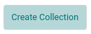
3. Select an existing project from the drop down – or – click *Add* to create a [new project](projects.md). Click the *Next* button. If you started from a project or mission, it's already selected.
4. Select an existing mission from the drop down – or – click *Add* to create a [new mission](missions.md). Click the *Next* button to open the form for creating the collection.
5. Fill out the form to create a new collection. The *Next* button stays disabled until the required fields are filled in.

   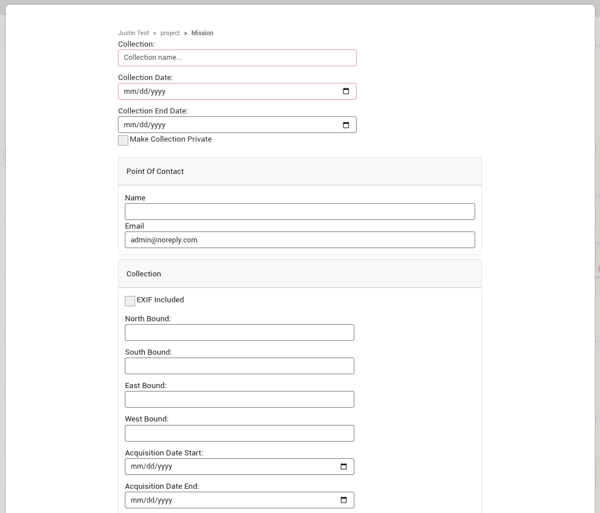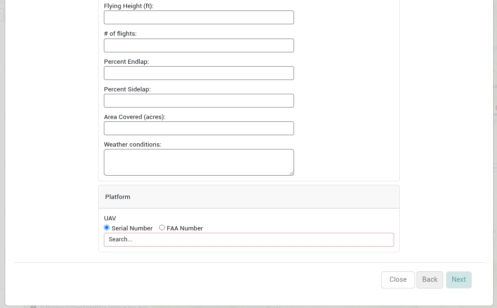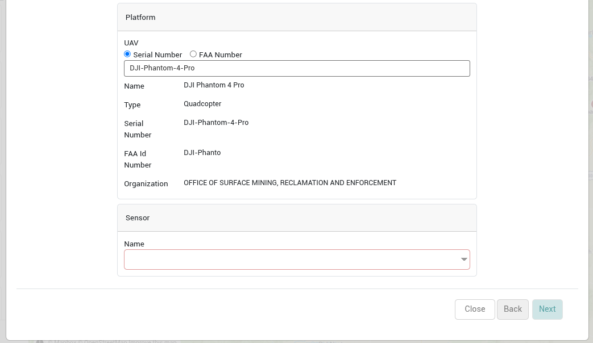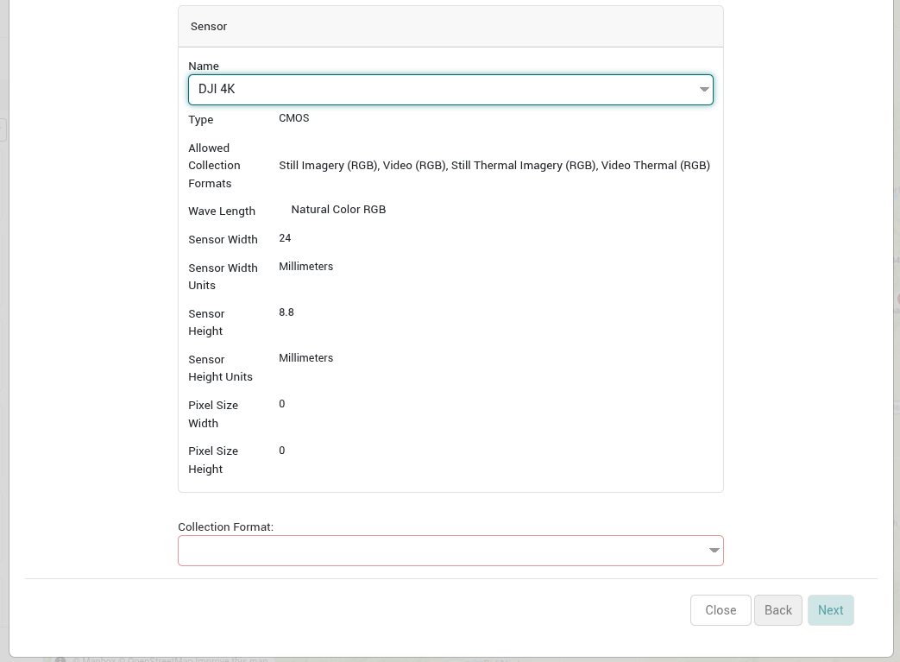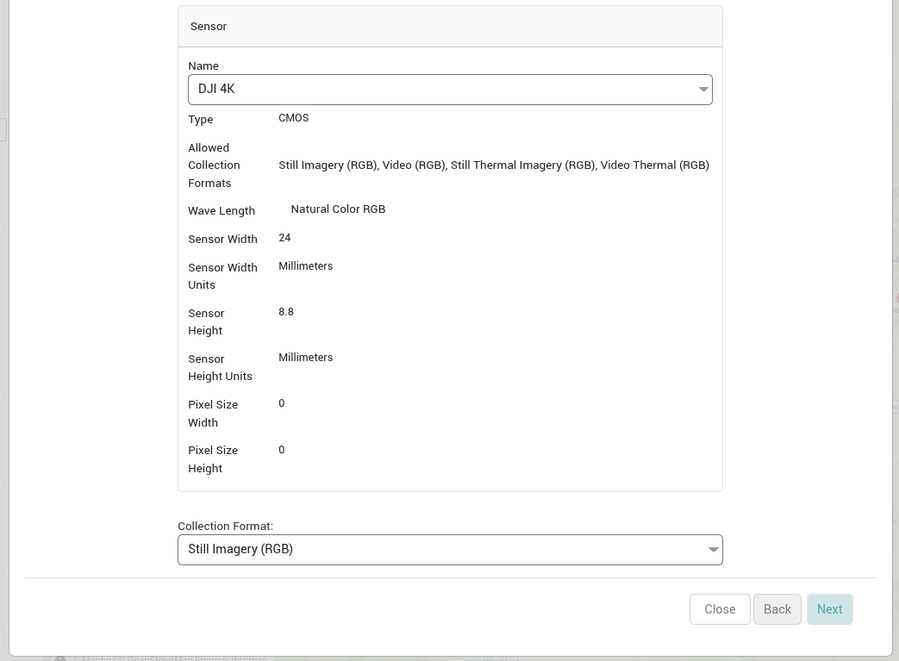
6. Click *Next* to see the summary page, then click *Create*. The collection and any projects or missions that were added in this process are created, and the new collection opens.

### Collection Fields

| Field | Description | Required |
|---|---|---|
| Collection | The name of the collection. | Yes |
| Collection Date | The date the collection is relevant for. Typically this is the day the data was collected in the field. If this collection period spans multiple days this should be the first day (see *collection end date*). | Yes |
| Collection End Date | The last day of a collection period when a collection spans multiple days. If left blank, it's set to the *Collection Date*. |  |
| Has PII Concern | Indicate if the data in the collection has any Personal Identifying Information (PII). When this option is checked the collection is marked as private and prevented from being published, and the *Make Collection Private* option is hidden. |  |
| Make Collection Private | Set the collection as being private. A private collection is only visible to its owner, collaborators the owner invites by email, and system administrators. See [Private Collections](private-collections.md).  No products can be published from private collections to ensure that all data from a private collection remains private. |  |
| **Point of Contact** |  |  |
| Point of Contact: Name | Name of the person who should be contacted if there are questions of the collection. |  |
| Point of Contact: Email | Email of the person who should be contacted if there are questions of the collection. |  |
| **Collection** |  |  |
| Collection: EXIF Included | A flag for indicating if there is metadata included in the EXIF headers of the data. |  |
| Collection: North Bound |  |  |
| Collection: South Bound |  |  |
| Collection: East Bound |  |  |
| Collection: West Bound |  |  |
| Collection: Acquisition Date Start | Date the acquisition started. |  |
| Collection: Acquisition Date End | Date the acquisition ended. |  |
| Collection: Flying Height (ft) | Height of the UAV during the acquisition flight. |  |
| Collection: # of flights | Number of flights taken to complete the acquisition. |  |
| Collection: Percent Endlap | Percent of endlap for the acquisition. |  |
| Collection: Percent Sidelap | Percent of sidelap for the acquisition. |  |
| Collection: Area Covered (acres) | Total area (in acres) covered for the acquisition. |  |
| Collection: Weather conditions | Weather conditions during the acquisition. |  |
| **Platform** |  |  |
| Platform: UAV | The UAV used for acquisition. Choose *Serial Number* or *FAA Number*, then search for the UAV and select it. | Yes |
| **Sensor** |  |  |
| Sensor: Name | The sensor used for acquisition. Shown after a UAV is selected, and lists only the sensors of that UAV. | Yes |
| Collection Format | Format of the data collected from the sensor. Shown after a sensor is selected, and lists only the formats the sensor allows (shown as *Allowed Collection Formats*). | Yes |

:::info

Don’t see the platform or sensor you used? Contact a system admin to add it for you before adding metadata for this collection. See [Platforms and Sensors](../../administration/platforms-and-sensors.md) and [UAV Registration](../../administration/uav-registration.md).

:::

## The Collection Modal

Uploaded data can be accessed and managed from the collection modal. You can find a collection by navigating the hierarchy in the Data or Products tabs of the Site Viewer sidebar, or with the *View Collection* button of a [workflow task](../workflow-tasks.md). Selecting a collection will open the collection modal.

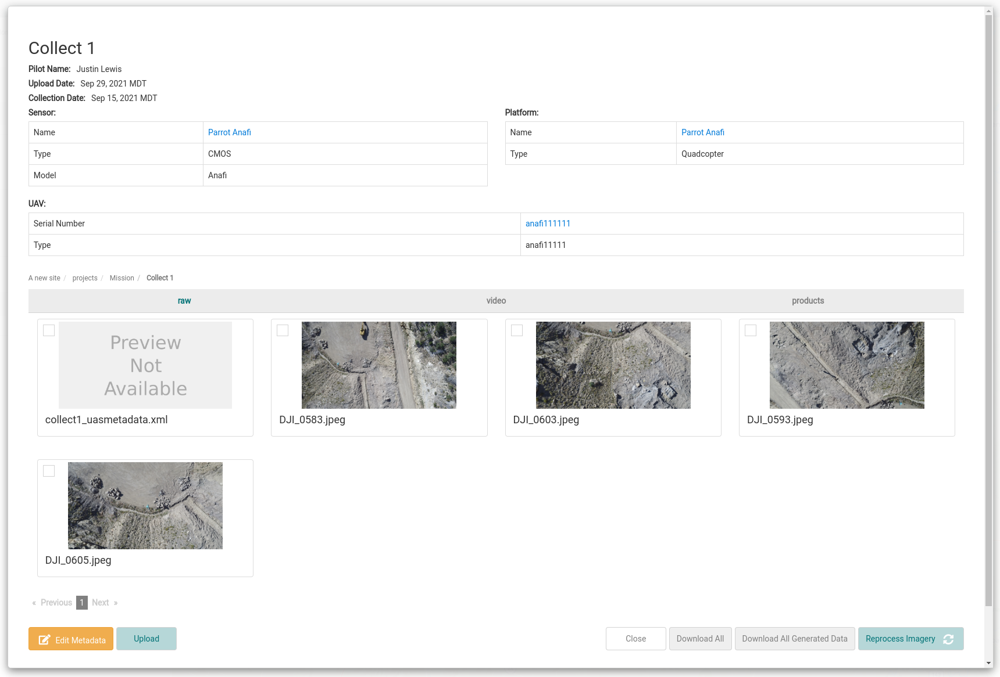

| Feature | Description |
|---|---|
| 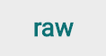 | “raw” contains all raw images uploaded in the collection. Here, images can be viewed and excluded from processing. Click an image to preview it. Right-click an image to open a menu with *Download image*, *Exclude image from processing* (or *Include image in processing* for an excluded image) and *Add to image set...*. Excluded images are shown dimmed.  For collections with a video *Collection Format*, the “raw” tab lists the uploaded videos instead of images. Click a video to play it.  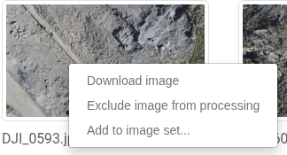  Excluded:  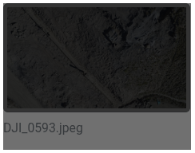 |
| 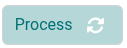 | “raw” is the only tab of the collection modal where you can process imagery into products, with the *Process* button. This runs ODM processing on the raw images that aren't excluded and creates a product from the outputs. See [Generating Products](../products/generating-products.md). This process can be monitored on the [Workflow Tasks](../workflow-tasks.md) page. |
|  | The “supporting data” tab lists the other files uploaded with the raw data, such as a geo location file (`geo.txt`). Each file has a *Download* button, and `geo.txt` also has a *Reupload* button. |
| 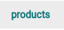 | The “products” tab displays the products of the collection. Each product is shown by its product name and has three sections:  - Ptcloud contains point cloud files. ODM processing creates a .laz point cloud. - DEM contains elevation files. ODM processing creates a DSM and a DTM, each as a Cloud Optimized GeoTIFF (.cog.tif). - Ortho contains image mosaic files. ODM processing creates an ortho mosaic as a Cloud Optimized GeoTIFF (.cog.tif) and as a PNG.  ODM processing also adds its processing report (report.pdf) to each section it creates. See [Generating Products](../products/generating-products.md#processing-outputs).  NOTE: All product assets can be either automatically created by IDM data processing or manually uploaded. |
| 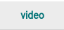 | The “video” tab only appears for older collections that were created without a *Collection Format*. It lists the videos uploaded to the collection. Click a video to play it. Collections with a video *Collection Format* show their videos in the “raw” tab instead. |
| 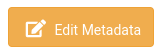 | The “Edit Metadata” button enables the ability to edit metadata for the collection |
| 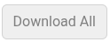 | The *Download All* button downloads a zip of the files on the tab you're on only: the raw images on the “raw” tab, the files on the “supporting data” tab, or the primary product's files on the “products” tab. |
| 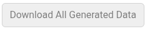 | The “Download All Generated Data” button downloads all outputs from automatic Open Drone Map (ODM) processing. It's only shown after the collection has been processed. See [Downloading Files](../downloading-files.md). |
|  | The “image-sets” tab lists the [image sets](../image-sets.md) created from the raw images of the collection. |
|  | The “Access Management” button is available on [private collections](private-collections.md) for inviting and removing collaborators. |
| 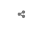 | The share icon at the top right of the collection modal, on the same line as the collection's name, copies a link to the collection to your clipboard. Other IDM users who open the link go straight to the collection, as long as they have access to it. |
