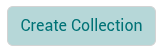
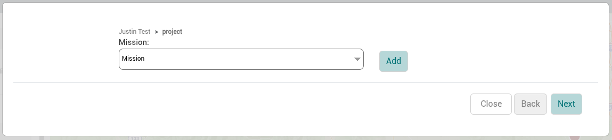
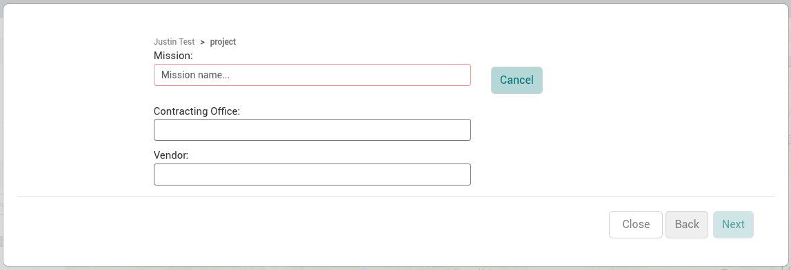

There can be one or more missions within a project. A mission defines a tactical field operation to collect data in a specific area, for a specific purpose, and within a specific time range.

:::info

Projects and missions are created as part of the [Create Collection](collections.md) form. The new mission will not be created until you successfully create a new collection using the same multi-step form you’re using to create this mission.

:::

## Create a Mission

1. From the sidebar of the Site Viewer, select a site.
2. Navigate into a project and click the *Create Collection* button at the bottom of the sidebar.

   
3. The modal for creating and managing data organization hierarchies will appear with the project section of the modal loaded by default. Select the project you want to add the mission to and click *Next*.
4. When on the section for selecting an existing mission or adding a new one, click the *Add* button. This will expand the options for creating a mission. Fill out the fields for the new mission.
5. Click *Next* to move to the next steps in the process for creating a collection.
6. Continue with the steps to [create a collection](collections.md).

### Mission Fields

| Field | Description | Required |
|---|---|---|
| Mission | Set the name of the mission. | Yes |
| Contracting Office | Set the name of the office that is managing the contract for this mission. |  |
| Vendor | Set the name of the vendor who is collecting the data for this mission. |  |
