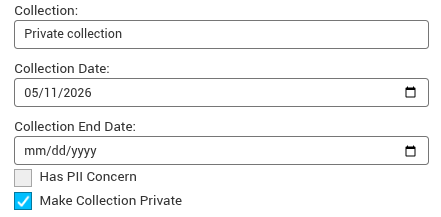
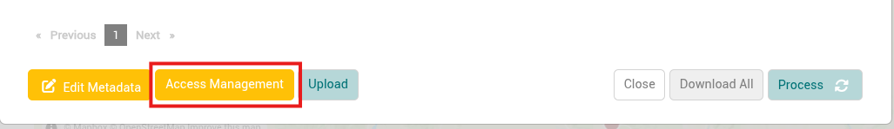
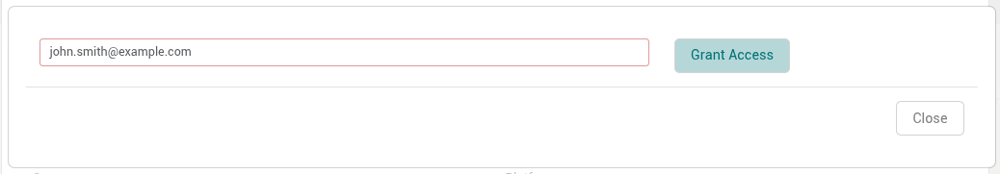
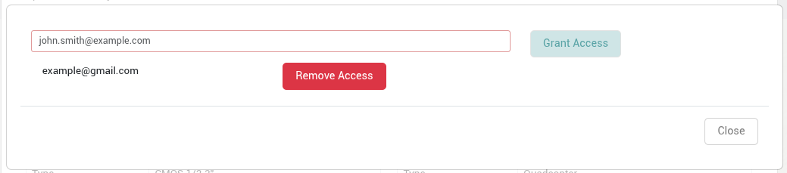

A private collection is hidden from other IDM users. Only these users can see it:

- the collection owner
- collaborators the owner has invited
- system administrators

Administrators can see private collections, but they can't view, download, publish or delete the collection's products unless the owner invites them as collaborators.

:::info

Once private:

- The collection owner can invite other individual IDM users to access the collection
- No products can be published from private collections to ensure that all data from a private collection remains private.
- A collection that already has published products can't be made private. Unpublish its products first.
- Checking *Has PII concern* on a collection makes it private automatically.

:::

## Creating a Private Collection

1. Follow the steps to [Collections](collections.md) if one doesn’t exist already.
2. Select the “Make collection private” option.

   
3. Press submit to save the changes.

## Inviting Collaborators to a Private Collection

Once a collection is private, the owner of that collection can grant access to other IDM users by email. Collaborators can use the collection like the owner, with these exceptions. Collaborators can't:

- invite or remove collaborators
- delete the collection
- change whether the collection is private
- lock or unlock its products

Only the collection owner sees the “Access Management” button. Administrators can't manage collaborators on another user's collection.

1. Log in as the collection owner.
2. Navigate to the private collection.
3. Click on the “Access Management” button at the bottom left of the collection modal.

   
4. Once pressed, the modal for adding collaborators will appear. Enter an email for the user who will be granted access to the private collection.

   
5. Click the “Grant Access” button.

## Revoke Access to a Private Collection

1. Log in as the collection owner.
2. Navigate to the private collection.
3. Click on the “Access Management” button at the bottom left of the collection modal.

   
4. Once pressed, the modal for managing collaborators will appear. Any existing collaborators will display with an option to “Remove Access”.

   
5. Press the “Remove Access” button for any user whose access must be removed.
