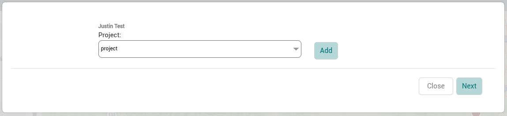
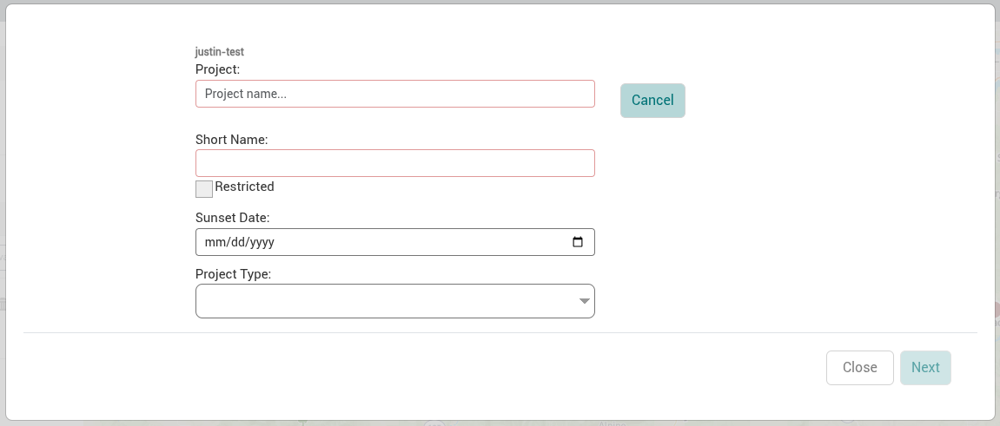

There can be one or more projects within a site. A project defines the operational project that all work is conducted for.

:::info

Projects and missions are created as part of the [Create Collection](collections.md) form. The new project will not be created until you successfully create a new collection using the same multi-step form you’re using to create this project.

:::

## Create a Project

1. From the sidebar of the Site Viewer, select a site.
2. Click the *Create Collection* button at the bottom of the sidebar.

   
3. The modal for creating and managing data organization hierarchies will appear. When on the section for selecting an existing project or adding a new one, click the *Add* button. This will expand the options for creating a project. Fill out the fields for the new project.
4. Click *Next* to move to the next steps in the process for creating a collection.
5. Continue with the steps to [create a collection](collections.md).

### Project Fields

| Field | Description | Required |
|---|---|---|
| Project | Set the name of the project. | Yes |
| Short Name | Set the short name of the project. A short name is a shortened version of the project name. | Yes |
| Restricted | Set the project as restricted. |  |
| Sunset Date | Set the date for when the project is expected to be complete and/or the data is at end of life.  This field is only for metadata purposes and no automated action is taken to modify or archive the data based on this date. |  |
| Project Type | Select the type of project. The options are: - Terrain - Imagery - Hydrography - Vegetation - Ecosystems - Forest Management - Fire & Aviation - Weather & Climate - Transportation - Recreation - Administrative Boundaries - Facilities & Infrastructure - Lands & Realty - Other |  |
