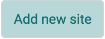
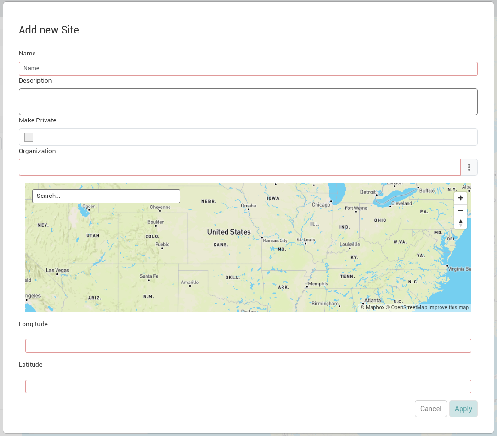

A site is the top most level of the [data hierarchy](../../getting-started/data-hierarchy.md) and includes the location of where the data is collected.

## Add a New Site

1. Select the “Add new site” button on the bottom of the sidebar of the IDM Sites page.

   
2. Fill out the new site form:

   
3. Submit the form. Your newly created site will appear on the map and in the sidebar.

### Site Fields

| Field | Description | Required |
|---|---|---|
| Name | The name of the site. | Yes |
| Description | A description of the site. |  |
| Make Private | Set the site as private so that only you (the site's owner) and system administrators can see it. Privacy isn't shared by organization; other users in your organization can't see a private site. |  |
| Organization | Set the organization (bureau) that you work for.  NOTE: if you are a cooperator with a federal agency please select that agency. | Yes |
| Site Location | Each site requires a location. To set a location you can: 1. Enter longitude and latitude coordinates in fields provided 2. Click on the map to populate the longitude and latitude fields 3. Search for a specific address using the search bar | Yes |
| Site Location: Longitude | Longitude for the location of the site. | Yes |
| Site Location: Latitude | Latitude for the location of the site. | Yes |
