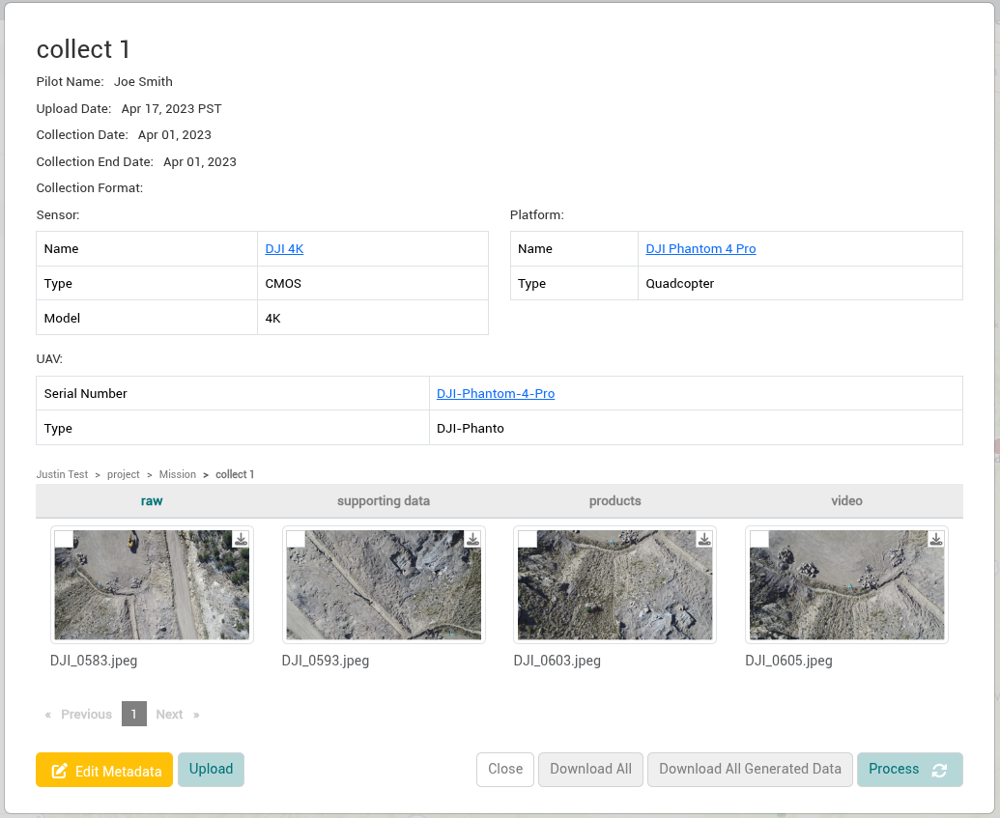
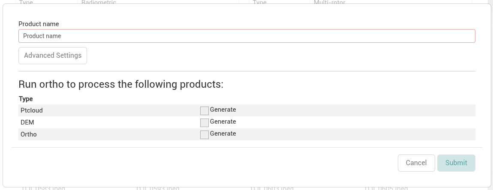
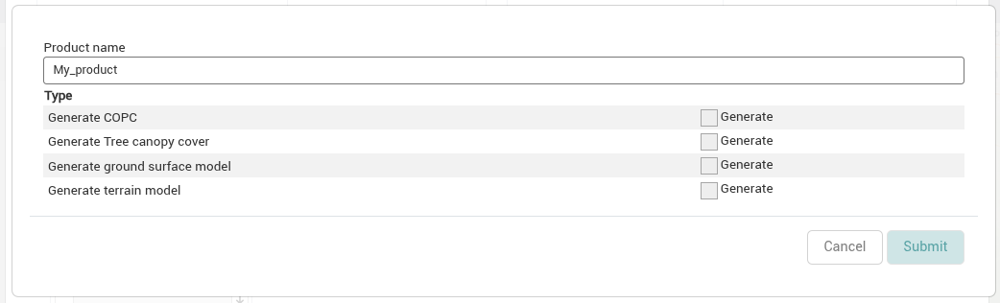
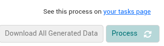
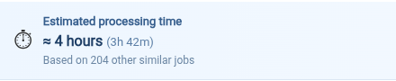
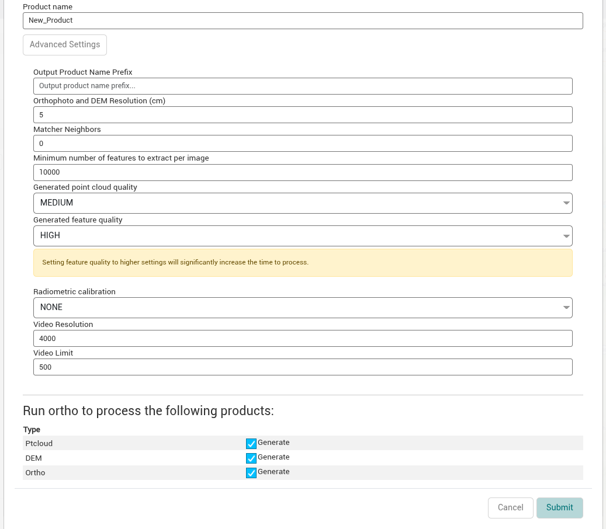

The [collection modal](../organizing-data/collections.md#the-collection-modal) is where all raw images that have been uploaded to a collection (in one or multiple uploads) and the most recently processed output products are stored. All products derived using IDM functionality are configured in the collection modal or the processing workflow and built from the data in the raw tab.

IDM has two kinds of processing, depending on the collection's data. They create different products and have different options:

| | [Imagery](#processing-imagery) | [LiDAR](#processing-lidar) |
|---|---|---|
| Collection data | Still imagery (RGB and thermal), multispectral imagery and video | LiDAR point clouds (LAS/LAZ) |
| Processed with | [Open Drone Map](https://docs.opendronemap.org/) (ODM), which stitches overlapping images together | [PDAL](https://pdal.io/) and [SilviMetric](https://github.com/hobuinc/silvimetric), which work directly on the point cloud |
| Products | Ortho mosaic, elevation models (DSM and DTM) and a point cloud generated from the images | Cloud Optimized Point Cloud (COPC), tree canopy cover, ground surface model and terrain model rasters |
| Options | Advanced Settings, estimated processing time, geo location and ground control point files | LiDAR product options only |

## Process Raw Data Into Products

These steps are the same for both kinds of processing. Only the options in step 3 differ.

1. Navigate to the collection you want to create derived products for and select the raw tab if it's not selected already.

   
2. OPTIONAL and **not available for video**: Exclude any raw images you want to exclude from the derived products. Right-click an image and select *Exclude image from processing*. Excluded images are shown dimmed; to include one again, right-click it and select *Include image in processing*. By default all images in raw will be included in image processing unless you choose to exclude them.
3. Click the *Process* button to open the processing options modal. The *Process* button is only shown on the raw tab, and it's disabled while a process is running. It's also disabled until the raw tab has at least two images, or at least one file for LiDAR and video collections.

   The modal shows different options for each kind of collection:

   - **Imagery collections** (still, thermal, multispectral and video): select one or more product types (*Ptcloud*, *DEM*, *Ortho*), and optionally review the *Advanced Settings*. See [Processing Imagery](#processing-imagery).

     
   - **LiDAR collections**: select one or more LiDAR products. See [Processing LiDAR](#processing-lidar).

     
4. Enter a *Product name*. It's required, and can only contain letters, numbers, periods and underscores (no spaces or special characters).
5. Click the *Submit* button. It's disabled until you enter a product name and select at least one product type.
6. When the processing options modal closes you’ll see a message indicating the job is running with a link to the processing job. The status of the processing job will be tracked on the [Workflow Tasks](../workflow-tasks.md) page and successful results from the task will be available on the products tab of the collection modal and the Site Viewer. See [Viewing Products](viewing-products.md).

   

:::info

If the job fails, see [Troubleshooting Processing Errors](../troubleshooting-processing-errors.md) for [imagery](../troubleshooting-processing-errors.md#imagery-processing-errors) and [LiDAR](../troubleshooting-processing-errors.md#lidar-processing-errors) processing errors.

:::

## Product Groups

The products a processing job creates are stored together in a *product group*, named after the *Product name* you enter. Product groups let a collection keep the results of several processing runs side by side, for example to compare different settings. They're listed on the products tab of the [collection modal](../organizing-data/collections.md#the-collection-modal).

- **New name, new group.** Processing with a new *Product name* creates a new product group. For imagery collections, the new group becomes the collection's *primary* group, which is the one downloaded by *Download All*.
- **Existing name, same group.** If the collection already has a product group with that name, the new outputs are added to that group instead.
- **LiDAR rasters get their own groups.** For LiDAR collections, the COPC point cloud goes in the group with your *Product name*, and each raster you select creates its own group named after it (for example, `myproduct_terrain_model`). See [LiDAR Products](#lidar-options).

You can also create a product group yourself, without processing, with the *Create product group* button on the collection's products tab. Use it to store products made with other tools, such as an ortho mosaic created in another application. See [Uploading Products](uploading-products.md#product-groups), which also explains how to make a different group primary and how to delete groups.

## Processing Imagery (Still, Thermal, Multispectral and Video) {/* #processing-imagery */}

Still imagery, thermal imagery, multispectral imagery and video are processed with Open Drone Map (ODM). ODM finds matching features in overlapping images and stitches them together into products. For video, IDM first extracts still frames from the video, and then processes them the same way.

### Imagery Products {/* #processing-outputs */}

Select one or more of these product types in the processing options modal:

| Product type | Files created |
|---|---|
| Ptcloud | A georeferenced point cloud (`odm_georeferenced_model.laz`), generated from the images. |
| DEM | A DSM (`dsm.cog.tif`) and a DTM (`dtm.cog.tif`), as Cloud Optimized GeoTIFFs, plus a hillshade of the DSM. |
| Ortho | An ortho mosaic as a Cloud Optimized GeoTIFF (`odm_orthophoto.cog.tif`) and as a PNG (`odm_orthophoto.png`). |

The `.cog.tif` files are Cloud Optimized GeoTIFFs, a [cloud native format](../../getting-started/cloud-native-formats.md) that lets the map, GIS software and published links read just the part of the file they need. The ODM processing report (`report.pdf`) is added to each product type you select. The full set of ODM outputs is kept as well, and can be downloaded with the *Download All Generated Data* button in the [collection modal](../organizing-data/collections.md#the-collection-modal).

### Estimated Processing Time

For imagery collections, the processing options modal shows an *Estimated processing time* at the top once you change a product type or setting. The estimate is based on earlier processing jobs with a similar amount of raw data and similar settings, and the modal shows how many of those jobs it used ("Based on N other similar jobs"). If there are no similar jobs, the estimate is *Unknown*.

### Georeferencing Options

Geo location and ground control point files are selected when you upload raw data, not when you process it. If a collection has a stored geo location file (`geo.txt`) or ground control point file (`gcp_list.txt`), IDM uses it automatically when processing. See [Geologger Files](geologger.md) and [Ground Control Points](ground-control-points.md).

If the collection's sensor needs a geo location file and none has been uploaded, the processing modal shows "Your sensor requires an uploaded geo location file" and you can't submit the job.

### Advanced Settings

When configuring a processing job to create products for an imagery collection there are Advanced Settings options that can be used to further refine the processing job.

The *Advanced Settings* section is always shown in the processing options modal, below the product types. Only the settings that apply to the product types you select are shown, so select the product types first. The *Shown when* column below lists when each setting appears.

   

#### Default Values

If the collection has been processed before, the processing options modal starts with the settings of the most recent processing job, including the product types that were selected. Only the *Product name* starts empty.

Otherwise, the modal starts with no product types selected and the defaults in the *Default* column below. If the collection's sensor is marked as *High Resolution* (see [Platforms and Sensors](../../administration/platforms-and-sensors.md)), the resolution defaults to 2 cm and the point cloud quality to HIGH instead.

#### Advanced Settings Fields

| Field | Description | Shown when | Default | Open Drone Map Docs |
|---|---|---|---|---|
| Orthophoto and DEM Resolution (cm) | Set the resolution for both orthophoto and elevation outputs. Orthophoto and DSM/DTM resolution in cm / pixel.  Note that this value is capped by a ground sampling distance (GSD) estimate. | *Ortho* or *DEM* is selected. | 5 (2 for high resolution sensors) | [orthophoto-resolution](https://docs.opendronemap.org/arguments/orthophoto-resolution/) and [dem-resolution](https://docs.opendronemap.org/arguments/dem-resolution/). |
| Matcher Neighbors | Perform image matching with the nearest images based on GPS exif data. Set to 0 to match by triangulation. | *Ortho* or *DEM* is selected. | 0 | [matcher-neighbors](https://docs.opendronemap.org/arguments/matcher-neighbors/). |
| Minimum number of features to extract per image | Minimum number of features to extract per image. More features can be useful for finding more matches between images, potentially allowing the reconstruction of areas with little overlap or insufficient features. More features also slow down processing. | *Ortho* or *DEM* is selected. | 10000 | [min-num-features](https://docs.opendronemap.org/arguments/min-num-features/). |
| Generated point cloud quality | Set point cloud quality. Higher quality generates better, denser point clouds, but requires more memory and takes longer. Each step up in quality increases processing time roughly by a factor of 4x. Options: ULTRA, HIGH, MEDIUM, LOW, LOWEST. | *Ptcloud* is selected. | MEDIUM (HIGH for high resolution sensors) | [pc-quality](https://docs.opendronemap.org/arguments/pc-quality/). |
| Generated feature quality | Set feature extraction quality. Higher quality generates better features, but requires more memory and takes longer. Options: ULTRA, HIGH, MEDIUM, LOW, LOWEST. | *Ortho* is selected. | HIGH | [feature-quality](https://docs.opendronemap.org/arguments/feature-quality/). |
| Radiometric calibration | Set the radiometric calibration to perform on images. When processing multispectral and thermal images you should set this option to obtain reflectance/temperature values (otherwise you will get digital number values). Options:  - *NONE*: no calibration. - *CAMERA*: applies black level, vignetting, row gradient gain/exposure compensation (if appropriate EXIF tags are found) and computes absolute temperature values. - *CAMERA+SUN (experimental)*: applies all the corrections of *CAMERA*, plus compensates for spectral radiance registered via a downwelling light sensor (DLS) taking in consideration the angle of the sun. | The collection has a radiometric or multispectral *Collection Format* (or no *Collection Format*). | CAMERA for radiometric and multispectral collections, otherwise NONE | [radiometric-calibration](https://docs.opendronemap.org/arguments/radiometric-calibration/). |
| Video Resolution | The maximum output resolution of extracted video frames in pixels. | The collection has a video *Collection Format* (or no *Collection Format*) and *Ortho* is selected. | Blank, which uses 4000 | [video-resolution](https://docs.opendronemap.org/arguments/video-resolution/). |
| Video Limit | Maximum number of frames to extract from video files for processing. Set to 0 for no limit. | The collection has a video *Collection Format* (or no *Collection Format*) and *Ortho* is selected. | Blank, which uses 500 | [video-limit](https://docs.opendronemap.org/arguments/video-limit/). |

:::info

The advanced settings are [Open Drone Map](https://docs.opendronemap.org/) settings, which is part of IDM's internal processing engine.

:::

## Processing LiDAR {/* #processing-lidar */}

LiDAR data is already a point cloud, so it isn't processed with ODM. Instead, IDM uses [PDAL](https://pdal.io/) (the Point Data Abstraction Library) and [SilviMetric](https://github.com/hobuinc/silvimetric) to work directly on the uploaded LAS/LAZ point cloud, converting it to a cloud optimized format and creating rasters from it.

LiDAR processing doesn't use the imagery product types (*Ptcloud*, *DEM*, *Ortho*), the Advanced Settings, the estimated processing time, or geo location and ground control point files.

### LiDAR Products {/* #lidar-options */}

For LiDAR collections, the processing options modal lists these products. None are selected by default.

| Option | Description |
|---|---|
| Generate COPC | Converts the uploaded LAS/LAZ point cloud to a Cloud Optimized Point Cloud (`pointcloud.copc.laz`), a [cloud native format](../../getting-started/cloud-native-formats.md), in the product. The raw tab must contain a single LAS/LAZ file. |
| Generate Tree canopy cover | Creates a tree canopy cover raster. |
| Generate ground surface model | Creates a ground surface model raster. |
| Generate terrain model | Creates a terrain model raster. |

Each raster option creates its own [product group](#product-groups), named after your *Product name* with the raster type added (for example, `myproduct_terrain_model`). The rasters are made from the COPC point cloud. If you don't select *Generate COPC* in the same job, a product group with the same *Product name* that already has a COPC point cloud must exist, otherwise the job fails.
