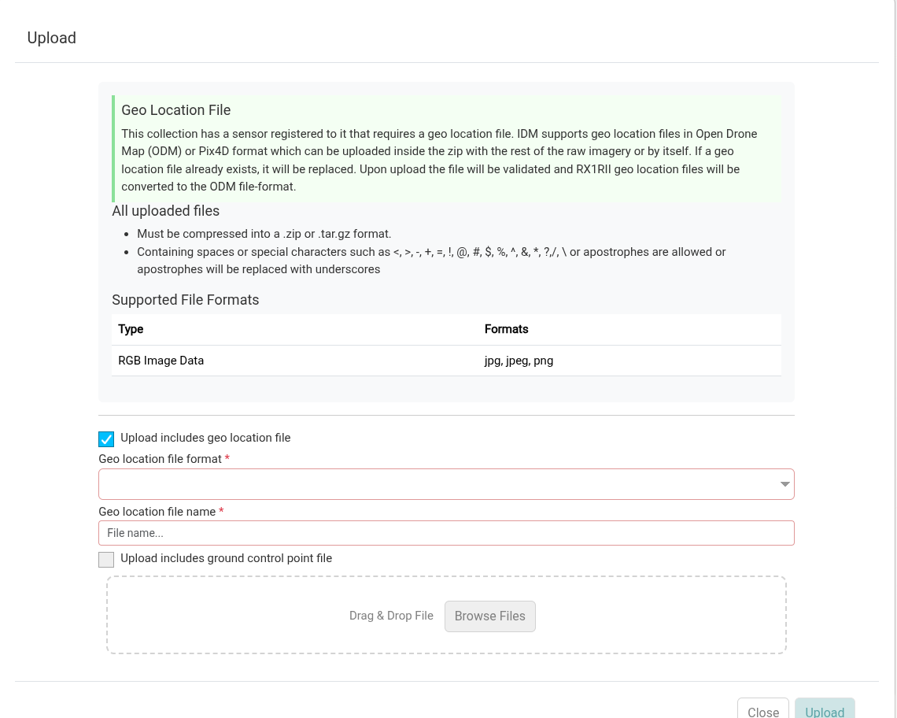
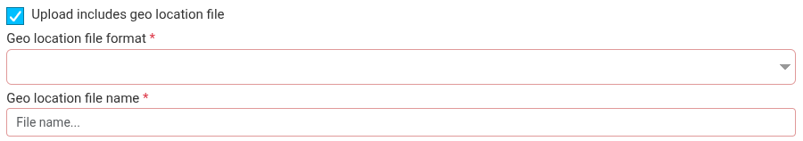

Many sensors contain embedded georeference information in their EXIF headers which are used for aligning raw images into mosaics. If this information does not exist in the EXIF headers a geologger file can be used (e.g. RX1R2 sensors).

Geo location file options only appear when the collection's sensor is registered as having a geologger. They are not available for video collections.

## Including a Geo Location File with a Raw Data Upload

1. Add the geo location (e.g. geologger) file to the zip file that contains the other raw images being [uploaded to IDM](../uploading-data/index.md).
2. In the upload modal, check *Upload includes geo location file*.

   
3. Fill in the two required fields:

   

   - *Geo location file format*: choose RX1R2 or ODM to match how your file is formatted. See [File Formats](#file-formats).
   - *Geo location file name*: the name of the geo location file inside the zip. The name is not case sensitive. Files named `geo.txt` or `pix4d.csv` are recognized automatically.
4. Click *Upload*.

When the upload finishes, IDM checks the geo location file against the images in the collection. An RX1R2 file is converted to the ODM format. The file is stored in the collection as `geo.txt`, which appears on the collection's *supporting data* tab. If the collection already has a geo location file, the new file replaces it.

You don't need to select the file again when you [process the collection into products](generating-products.md). IDM uses the stored `geo.txt` automatically.

:::warning

If the sensor needs a geo location file and the collection doesn't have one, IDM will not let you process the collection. The processing modal shows "Your sensor requires an uploaded geo location file."

If you check *Upload includes geo location file* but IDM can't find a file with that name in the zip, the upload fails.

:::

## Adding a Geo Location File to a Collection With Raw Data Already Uploaded

A geo location file can be uploaded by itself. Do this if raw data was uploaded to a collection without the geo location file, or if the geo location file needs to be replaced.

1. Zip the geo location file by itself.
2. Open the collection that the geo location file must be added to.
3. Click the *Upload* button on the raw tab to open the upload modal. If the collection already has a geo location file, you can also click *Reupload* next to `geo.txt` on the *supporting data* tab.
4. Add your zipped geo location file to the upload modal.
5. Check *Upload includes geo location file* and fill in the format and file name, as described above.
6. Click *Upload*.

## File Formats

### ODM

ODM based geologger files must be in .txt format adhering to the following file specification:

```
projection
image_name geo_x geo_y [geo_z] [omega (degrees)] [phi (degrees)] [kappa (degrees)] [horz accuracy (meters)] [vert accuracy (meters)] [extras...]
```

Example:

```
EPSG:4326
DJI_0028.JPG -91.9942096111111 46.84252125 198.609
DJI_0032.JPG -91.9938293055556 46.8424584444444 198.609
```

### RX1R2 (Pix4D)

RX1R2 (Pix4D) based geologger files can be in .txt or .csv format and must adhere to the following file specification:

```
imagename,geo_y,geo_x,z
```

Example:

```
IMG_3165.JPG,46.2345612,6.5611445,539.931
IMG_3166.JPG,46.2323423,6.5623423,529.823
```
