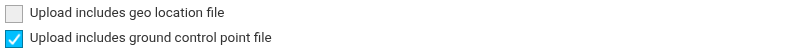
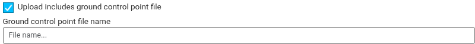

Ground control points are useful for correcting distortions in the data and referencing the data to known coordinate systems. A Ground Control Point (GCP) is a position measurement made on the ground, typically using a high precision GPS. (Toffanin 2019)

:::warning

A minimum of 5 GCPs are required for adjusting the model. Each GCP needs to be clearly visible and have coordinates on at least 3 photos.

For improved accuracy, use 5 to 10 GCPs that are evenly spread across the project area.

:::

## Using a Ground Control Point File

Ground control point files can't be used with video collections.

1. Add the ground control point file to the zip file that contains the other raw images being [uploaded to IDM](../uploading-data/index.md).
2. In the upload modal, check *Upload includes ground control point file*.

   
3. Optionally, enter the *Ground control point file name*. The name is not case sensitive. If you leave it blank, IDM looks for `gcp_list.txt`.

   
4. Click *Upload*.

IDM recognizes a file named `gcp_list.txt` even if you don't check the box. A file with any other name is only used if you check the box and enter its name.

When the upload finishes, IDM checks the file against the [GCP File Format](#gcp-file-format) and the images in the collection. The file is stored in the collection as `gcp_list.txt`. If you checked the box but IDM can't find the file in the zip, the upload fails.

You don't need to select the file again when you [process the collection into products](generating-products.md). IDM uses the stored `gcp_list.txt` automatically.

## GCP File Format

IDM checks the GCP file when it is uploaded. A file that does not follow these rules is rejected.

- The file must be a text file with a .txt extension.
- The first line must be exactly `EPSG:4326`. Coordinates must be WGS84 longitude and latitude in decimal degrees. Other projections, such as UTM or PROJ strings, are not accepted. Convert your GCP coordinates to EPSG:4326 before uploading.
- Each following line describes one GCP as seen in one image. Separate values with spaces or tabs, and do not include blank lines. Each line must contain at least these six values, in this order:
  1. `geo_x`: longitude, between -180 and 180
  2. `geo_y`: latitude, between -90 and 90
  3. `geo_z`: elevation
  4. `im_x`: pixel column of the GCP in the image
  5. `im_y`: pixel row of the GCP in the image
  6. `image_name`: the name of an image in the collection. It must match the image file name exactly, including upper and lower case.
- The first five values must be numbers. Do not use "NaN" for an unknown elevation; use 0.0 instead.
- Keep at least 7 decimal places in longitude and latitude. 0.0000001 degrees is about 1 cm on the ground, so rounding off digits reduces accuracy.
- An optional 7th column typically contains the label of the GCP. Any further columns are ignored.

```
EPSG:4326
geo_x geo_y geo_z im_x im_y image_name [gcp_name] [extra1] [extra2]
...
```

Example:

```
EPSG:4326
-122.4062503 48.0400297 5 3044 2622 IMG_0525.jpg
-122.4075806 48.0398503 5 4193 1552 IMG_0585.jpg
-122.4092505 48.0396502 5 1606 2763 IMG_0690.jpg
```
