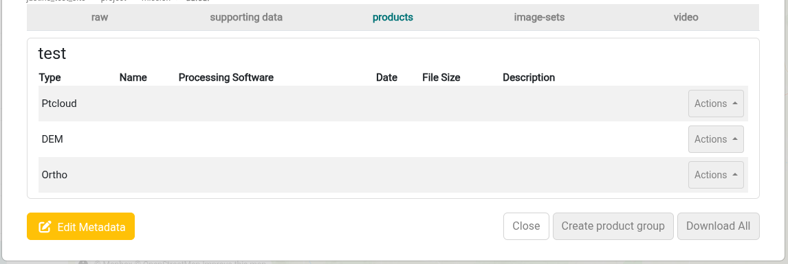
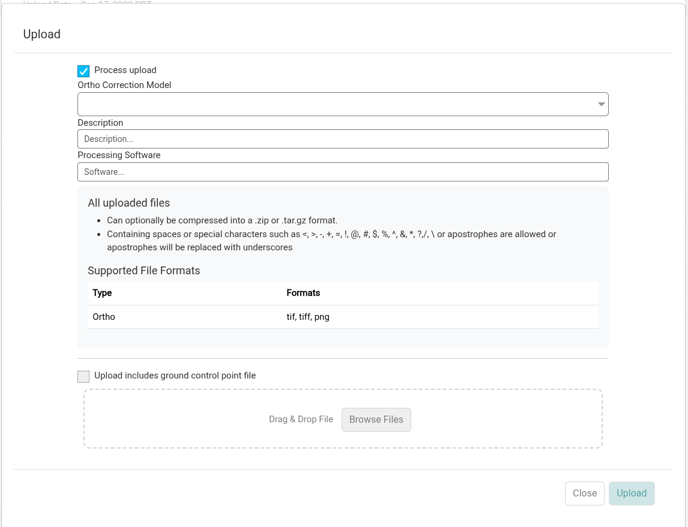
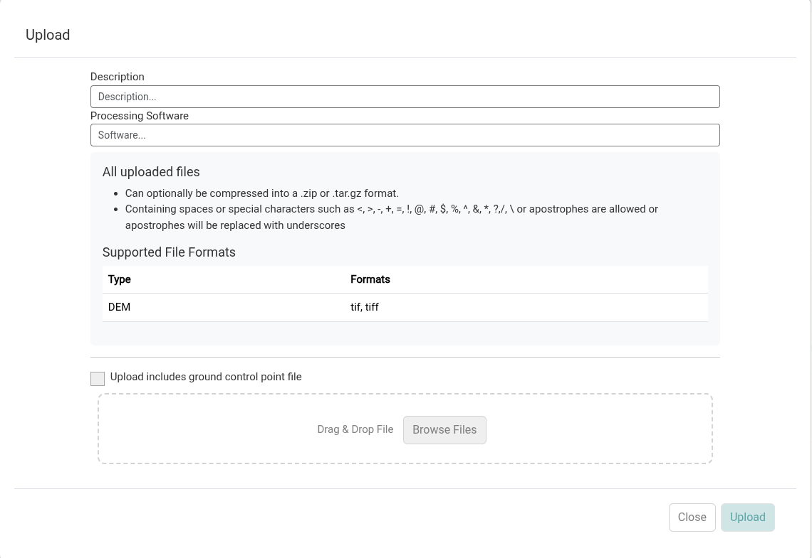
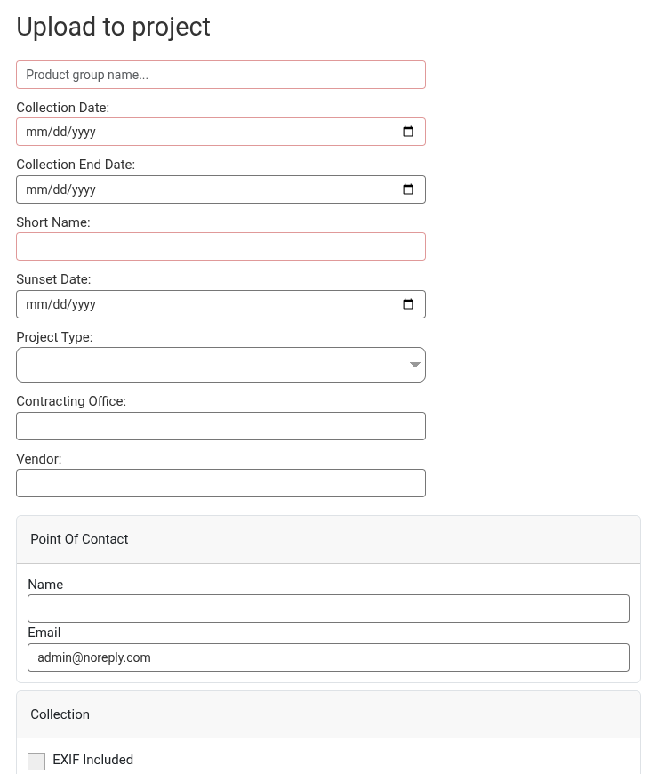

Products created or refined using external tools can be uploaded to the products tab of a collection for storage. Products can also be [uploaded to a project or mission without a collection](#upload-products-without-a-collection), when you have products but no raw data to store in IDM.

## Product Groups

Products in a collection are organized into product groups. Each group can hold one ortho, one DSM, one DTM and one point cloud, plus a report for each. Each time a collection is [processed](generating-products.md), a new product group is created.

One product group in each collection is the *primary* group. The primary group is the one downloaded by the collection's *Download All* button. A new product group, whether created by processing or with *Create product group*, becomes the primary group.

- To make a different group primary, click *Make Primary* on it.
- To delete a group, click *Delete Group* on it. The primary group can't be deleted directly; make another group primary first.

## Upload a Product

1. Navigate to the products tab of the collection modal.
2. If you want the products in a new product group, click *Create product group*, enter a *Product name*, and click *Submit*. The name can only contain letters, numbers, periods and underscores. The new group becomes the primary group.

   
3. Click the *Actions* button on the right of the row for the type of product you want to upload, and select the upload option:
   - **Ortho:** *Upload*
   - **DEM:** *Upload DSM* or *Upload DTM*. A product group can hold both a DSM and a DTM.
   - **Ptcloud:** *Upload*

   An upload option is only shown while that slot is empty. To replace a product, first select *Remove* (or *Remove All*) from the same menu.

   
4. Select the file to upload, fill out the form, and click *Upload*.

   

### Supported File Types

| Product | File types |
|---|---|
| Ortho | tif, tiff, png |
| DEM (DSM or DTM) | tif, tiff |
| Point cloud | las, laz |

Each product can also be uploaded inside a .zip or .tar.gz file.

### Upload Fields

| Field | Shown for | Description |
|---|---|---|
| Process upload | Ortho | Select whether you want IDM to generate the supporting files needed to view and stream your data or (if un-checked) to simply store the file as uploaded.  **If checked,** IDM converts the file to a Cloud Optimized GeoTIFF (COG) and a PNG preview image (thumbnail).  **If unchecked,** the file is still uploaded and attached to the product, but it won't have a preview and won't be viewable on IDM's map.  Un-check this option if the file is already in the format you want to store it in and you don't want IDM to create derivatives for additional IDM functionality beyond storage.  NOTE: Uploaded ortho and elevation products are kept in their original format while an additional COG is created to support cloud native functionality in IDM and for publishing. |
| Ortho Correction Model | Ortho | The elevation model the ortho was corrected (orthorectified) with: DSM, DTM or Unknown. |
| Enable Potree viewer for point cloud | Point cloud | If checked, IDM builds a tiled version of the point cloud (Potree format). This is required for the point cloud to be viewable in the web-based Potree viewer. If unchecked, the file is stored but won't render in that viewer. |
| Point Cloud EPSG Number | Point cloud | The EPSG code of the point cloud's coordinate system. |
| Point Cloud Projection Name | Point cloud | The name of the point cloud's projection. |
| Description | All | A description of the product. |
| Processing Software | All | Enter the software used to create the product being uploaded (ex: Pix4D). |

DSM and DTM uploads are always processed: IDM converts the file to a COG and generates a hillshade image from it, which is used to visualize it on the map.

### Reports

Each product row's *Actions* menu also has *Upload report* (or *Reupload report*) for attaching a PDF report to that product, and *Download report* once a report exists.

## Upload Products Without a Collection

If you have products but no raw data to store in IDM, you can upload them directly to a project or mission. IDM creates a standalone product group for them, with the same metadata as a collection.

1. In the Site Viewer, navigate to the project or mission you want to add the products to.
2. Click the *Upload Products* button at the bottom of the sidebar. The button isn't shown at the site level.

   
3. The *Upload to [project or mission name]* form opens. Fill it out:
   - *Product group name*: a name for the product group.
   - *Collection Date* (required) and *Collection End Date*: when the data was collected.
   - Optional metadata: *Short Name* (up to 8 characters), *Sunset Date*, *Project Type*, *Contracting Office* and *Vendor* (up to 50 characters each).
   - The UAV, sensor and *Collection Format* (all required), and other collection metadata. These are the same fields as when [creating a collection](../organizing-data/collections.md#collection-fields).

   
4. Click *Create*. The new product group opens.
5. Upload each product from the actions button for its type, as described in [Upload a Product](#upload-a-product) (steps 3 and 4).

Standalone product groups are listed in the *Products* tab of the Site Viewer sidebar along with collection products. See [Viewing Products](viewing-products.md).
