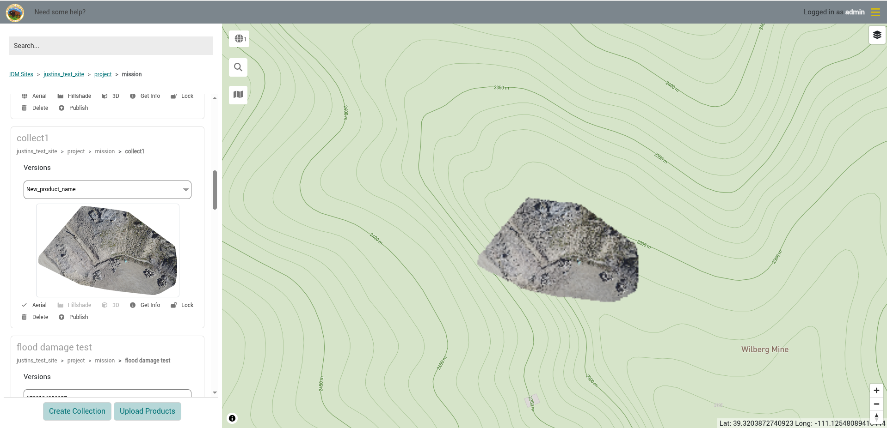
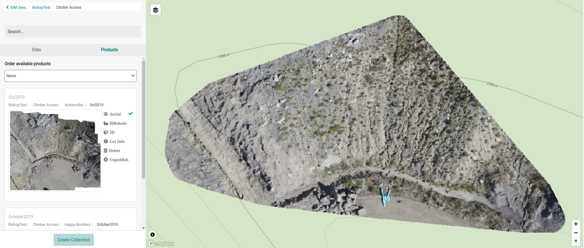
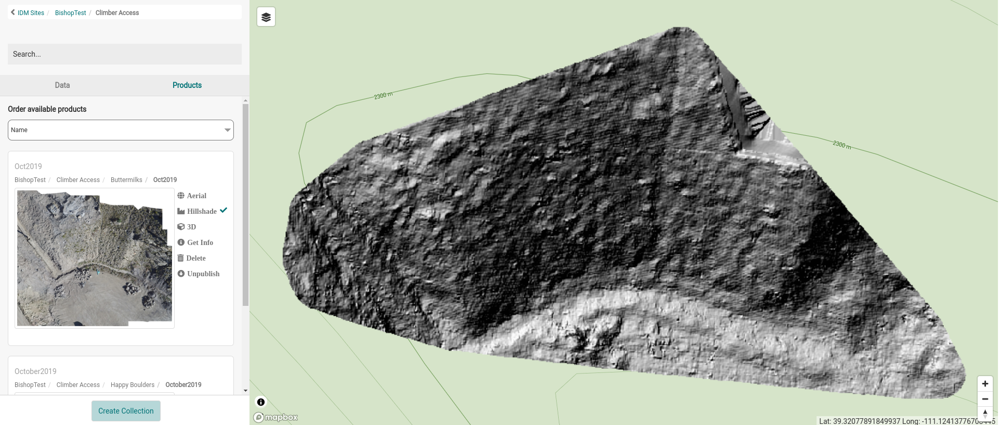
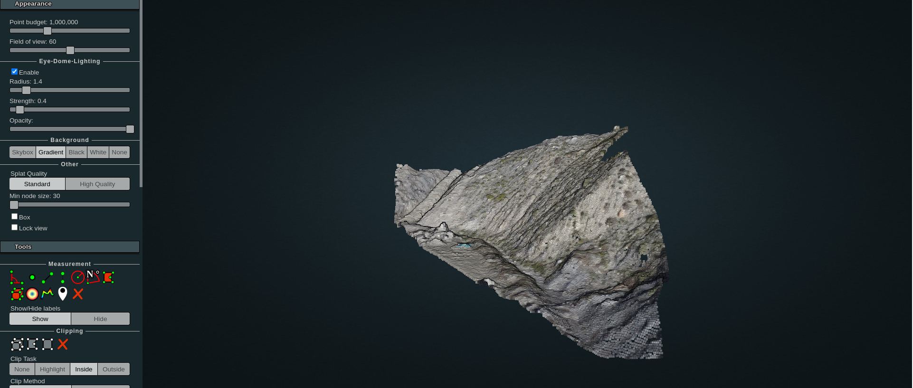
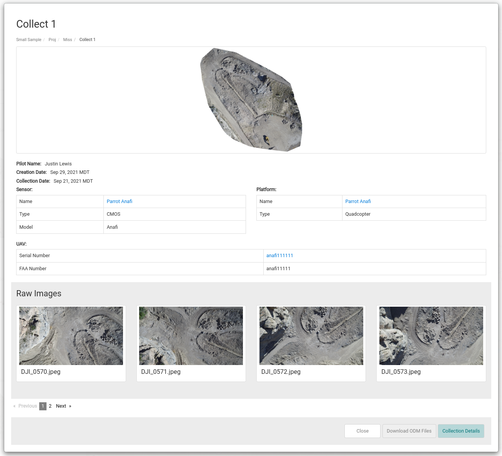

Products can be viewed from the products tab of a collection or from the Products tab of the Site Viewer sidebar.

## Viewing Products in a Collection

You can view and download output products on the products tab of the [collection modal](../organizing-data/collections.md#the-collection-modal). The tab lists each [product group](uploading-products.md#product-groups) in the collection, with a table of its files: Type, Name, Processing Software, Date, File Size and Description. Click a file name to download it.

Each processing run creates a new product group, and the newest group becomes the primary group. If you would like to recreate the products using a different set of images, you can [process the imagery again](generating-products.md); earlier product groups are kept until you delete them.

## Viewing Products in the Site Viewer

You can also view products in the *Products* tab of the Site Viewer sidebar. The *Products* tab will show all product groups that exist at or below the level of the hierarchy you are drilled into. For example, if you are on the project level of the hierarchy you will see all products at that level. If you navigate down a level to a specific mission the products will be filtered to just the products that exist for that mission.

Use *Order available products* at the top of the tab to sort the list. If a collection has more than one product group, use its *Versions* list to choose which group to show.

Clicking on the preview thumbnail of a product will bring up a larger preview to view more detail. Each product has the following actions. An action is disabled or hidden when it doesn't apply, for example *Aerial* when the product has no ortho.

| Action | Description |
|---|---|
| Aerial | Maps the image mosaic of the product on the map and zooms to the extent of the image mosaic.   |
| Hillshade | Maps the elevation hillshade of the product on the map and zooms to the extent of the hillshade.   |
| 3D | Opens a new browser tab with a 3D (Potree) viewer containing the point cloud for the product group.   |
| Get Info | Opens a detail modal with the raw image information and a link to the collection. See [Product Details](#product-details). |
| Lock / Unlock | Only shown to Administrators. Locks the product so that it can't be deleted, published or unpublished until it is unlocked. See [Locked Products](#locked-products). |
| Delete | Brings up a modal that asks you to confirm that you want to delete the product, and removes the selected product if you select “Delete”. Only the collection's owner and Administrators can delete products. Not shown for locked or published products. |
| Publish / Unpublish | Publishes the product to the public. Once a product is published this option will change to “Unpublish” and you may select this to make the product no longer available to the public. Not shown for locked products. See [Publishing Products](../publishing-products.md). |
| Share | Only shown for published products. Opens the public links for the product. See [Sharing a Published Product](../publishing-products.md#sharing-a-published-product). |

### Locked Products

A locked product can't be deleted, published or unpublished. Administrators can lock and unlock products from the Products tab.

Products in a collection marked as having a PII concern are locked automatically, so they can't be published.

### Product Details

Selecting “Get Info” will open a detail modal with the following:

- Thumbnail of the produced output
- Collection information including:
  - Pilot Name
  - Date the Collection was created
  - Date the data was created in the field
  - Sensor Information
  - Platform information
  - UAV information
- All Raw Images used to create the produced output

Select the *Collection Details* button to access the collection directly. This is where you will be able to manage raw images. This button isn't shown for products [uploaded without a collection](uploading-products.md#upload-products-without-a-collection).

Select the *Download ODM Files* button to download a zip file of all output Open Drone Map produced for the collection. This button is only shown when that file exists.
