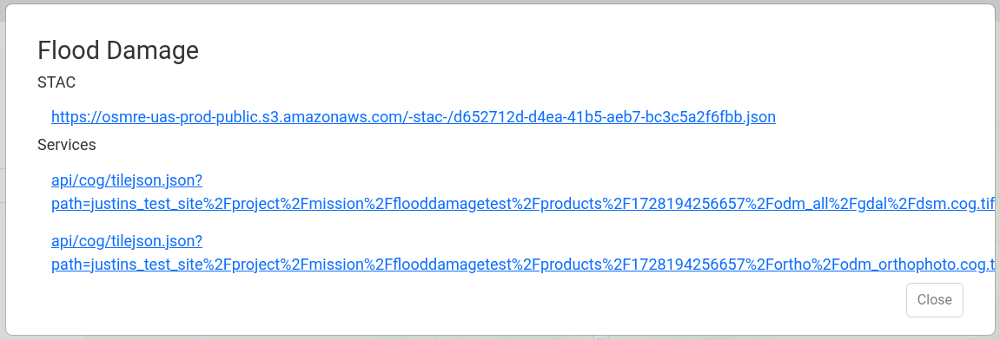

Products can be shared publicly by publishing a specific product. The publish functionality registers the product on the public IDM [Know-STAC](../know-stac.md) and makes a variety of methods for accessing the data available to anyone outside of IDM.

When you publish a product, IDM:

- copies the product's files and preview images to a public cloud storage bucket
- creates a public STAC item describing the product
- registers the product in Know-STAC, where anyone can find it

Unpublishing removes the public copies and the Know-STAC entry.

**Access Types to a Published Product**

- Map tile services (TileJSON)
- Direct cloud native access (Cloud Optimized GeoTIFF). See [Public Image Services](../administration/public-image-services.md).
- Public IDM Know-STAC

## Publish a Product

1. Find the product in the *Products* tab of the Site Viewer sidebar. See [Viewing Products](products/viewing-products.md).
2. Select *Publish* on the product.

   

Once a product is published this option will change to *Unpublish*. Select it to make the product no longer available to the public.

:::info

Products can't be published from [private collections](organizing-data/private-collections.md) or from collections marked as having a PII concern. Products in a PII collection are [locked](products/viewing-products.md#locked-products), and locked products can't be published or unpublished.

A published product can't be deleted; unpublish it first. A collection with published products can't be made private.

:::

## Sharing a Published Product

1. Find the published product in the *Products* tab of the Site Viewer sidebar.
2. Select *Share* on the product. A dialog opens with the product's public links:
   - **STAC:** the URL of the product's public STAC item. It describes the product and links to its files.
   - **Services:** map tile service (TileJSON) links for the product's ortho and elevation layers, for use in web maps and GIS tools.

   
3. Copy the link you need and share it.

## What is Know-STAC

Know-STAC (Knowledge-Enabled STAC) is a semantic layer and storage application for making STAC searches interoperable across agencies and domains. STAC (Spatio Temporal Asset Catalog) is a standard for describing and organizing cloud native data on the cloud. IDM ortho mosaics, elevation rasters, and point clouds are all stored in cloud native formats which are all registered in Know-STAC when published. This means that products published in IDM are more:

- findable because that data is part of a standardized STAC specification
- accessible because the data a Know-STAC item points to are in cloud native formats
- shareable because the data is accessible by web URLs

The Know-STAC browser is a web application for searching Know-STAC. See the [Know-STAC](../know-stac.md) documentation for more information.
