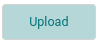

import ZipRequirements from './_zip-requirements.md';

Still imagery (RGB) can be uploaded to the raw directory of collections for storage as well as for further processing into derived products.

## Supported Cameras

Images from most RGB cameras can be uploaded and processed. To process images into products, IDM needs each image's location, either from the GPS information in the image's EXIF header or from a [geo location file](../products/geologger.md).

The following cameras have known limitations in IDM:

1. Sony LR1: Limited support. The LR1 produces very large images, and processing large LR1 collections can fail. Processing has been more successful when a collection's raw data is no more than 20 GB.

## Requirements

<ZipRequirements example="IMG_001.jpg" />

:::info

It is best to zip all images you want to upload into a single .zip file rather than doing multiple uploads. The application was designed to handle very large .zip files (containing a lot of images) even in a low bandwidth environment.

:::

## Prerequisites

1. [Create a collection](../organizing-data/collections.md) if one doesn’t exist.

## Upload Still Imagery Data (radiometric or non-radiometric)

1. Select the upload button from the collection modal you want to upload imagery to. A new upload modal will load on the screen.

   
2. Drag & drop your compressed (.zip) file onto the “Drag & drop” area at the bottom of the form – or – click “Select file” to select your compressed (.zip) from the file system.
3. Select Upload to start the process.

:::info

OPTIONAL: Once your data is uploaded you can navigate to the collection and [process your raw data into derivative products](../products/generating-products.md). You can monitor the upload on the [Workflow Tasks](../workflow-tasks.md) page.

:::

### Including a Geologger Configuration File

1. Add the geo location (e.g. geologger) file to the zip file that contains the other raw images. See [Geologger Files](../products/geologger.md) for more information.

### Including a Ground Control Point (GCP) Configuration File

1. Add the ground control point file to the zip file that contains the other raw images. See [Ground Control Points](../products/ground-control-points.md) for more information.

## Processing Into Products

Still imagery can be processed into ortho mosaics, elevation models (DSM and DTM) and point clouds.

- [Process Raw Data Into Products](../products/generating-products.md#process-raw-data-into-products): the steps for starting a processing job.
- [Imagery Products](../products/generating-products.md#processing-outputs): the files each product type creates.
- [Advanced Settings](../products/generating-products.md#advanced-settings): resolution, quality and other processing settings. For radiometric thermal imagery, see *Radiometric calibration* in the [Advanced Settings Fields](../products/generating-products.md#advanced-settings-fields).
- [Geologger Files](../products/geologger.md) and [Ground Control Points](../products/ground-control-points.md): improving the location accuracy of your products.
