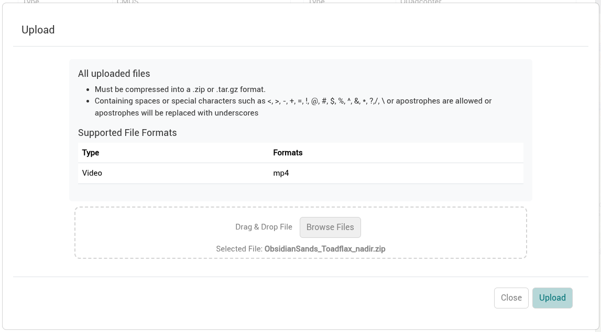

import ZipRequirements from './_zip-requirements.md';

Videos can be uploaded to the raw directory of collections for storage as well as for further processing into derived products.

## Requirements

- IDM administrators configure sensors for the formats allowed to be used. A video format must be selected as one of those sensor options. You can view the enabled formats in the sensor definition by clicking the sensor name in the top of the collection and referencing the *Formats Captured With This Sensor* section.
- Only one video can be uploaded per upload.

<ZipRequirements example="video_name.mp4" />

## Prerequisites

1. [Create a collection](../organizing-data/collections.md) if one doesn’t exist.
2. Set the sensor format to a video format for the collection.

## Upload Video (radiometric or non-radiometric)

1. Select the upload button from the collection modal you want to upload a video to. A new upload modal will load on the screen.

   
2. Drag & drop your compressed (.zip) file onto the “Drag & drop” area at the bottom of the form – or – click “Select file” to select your compressed (.zip) from the file system.

   
3. Select Upload to start the process.

:::info

OPTIONAL: Once your video is uploaded you can navigate to the video tab of your collection to see all uploaded videos and preview them as needed.

:::
