The Workflow Tasks page is the central location for monitoring data uploads and processing, and for actions required on data that has been uploaded. Open it by choosing *Workflow Tasks* from the navigation menu in the upper right of the application.

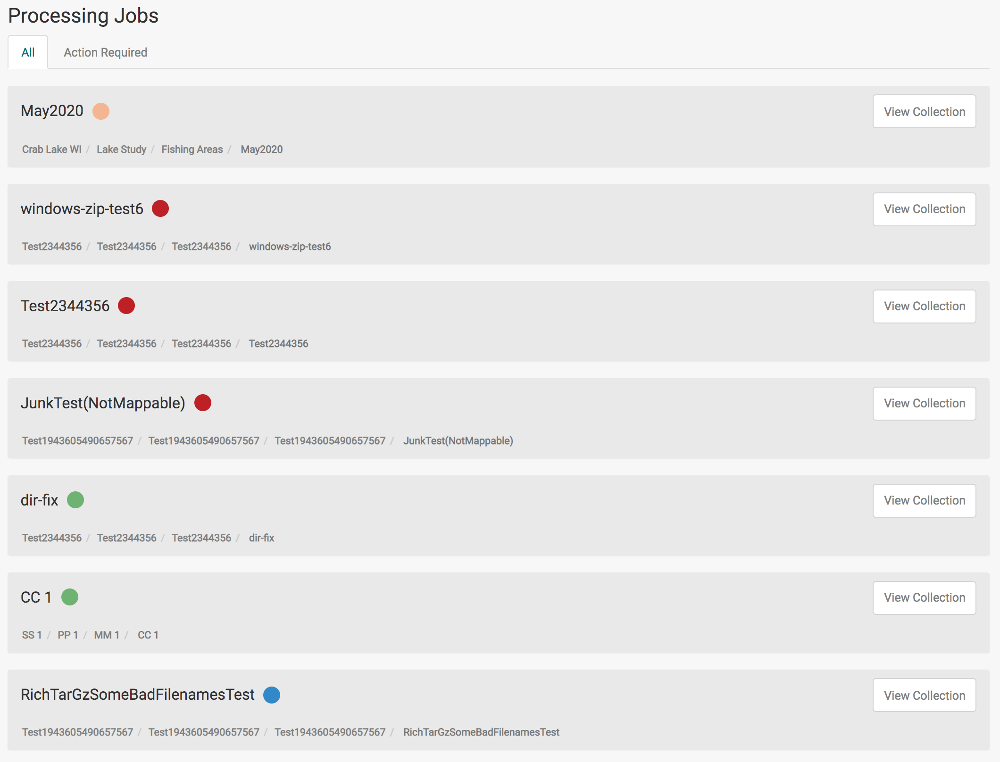

The page has two main sections: [Tasks](#tasks) and [Processing Jobs](#processing-jobs).

## Tasks

The Tasks section appears only when there are tasks that need your attention. It provides a list of items that the user needs to take action on in order to complete the item’s workflow; like filling out metadata for example. Each item in the list has a description of the issue and buttons to associated actions.

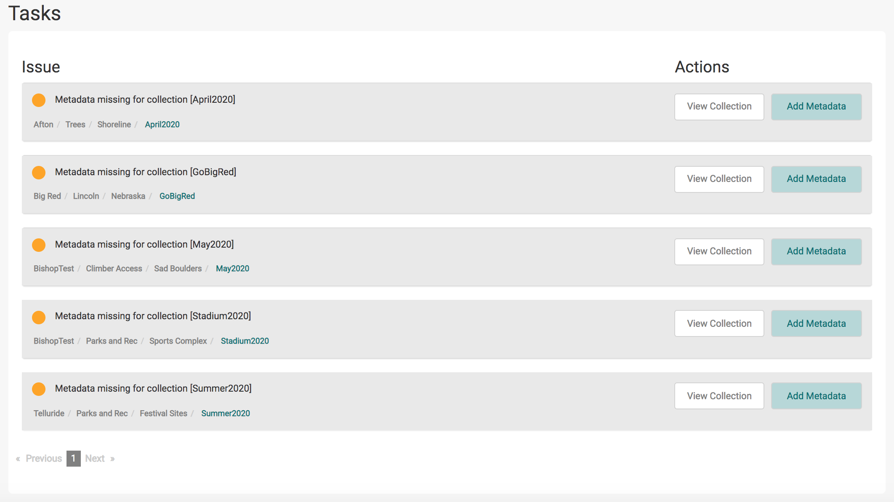

| Feature | Description |
|---|---|
| 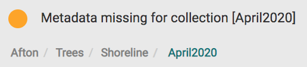 | The issue description contains details about the problem with the associated collection in [ ]. The Site / Project / Mission / Collection is also listed for reference. |
| 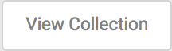 | Select *View Collection* to open the [collection modal](organizing-data/collections.md#the-collection-modal) associated with the task. |
| 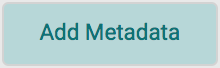 | Select the *Add Metadata* button to open a form to complete the metadata for the collection. Completing the metadata will complete the task and remove it from this list. |

## Processing Jobs

The Processing Jobs section provides a list with the status of all uploads and processing for your user. The name of the job in the list is the collection name, and the Site / Project / Mission / Collection is also listed for reference. Select *View Collection* to open the collection modal associated with the job.

For product uploads that are not attached to a collection, the job is named after the product and has a *View Product* button instead. *View Product* opens the details of the product.

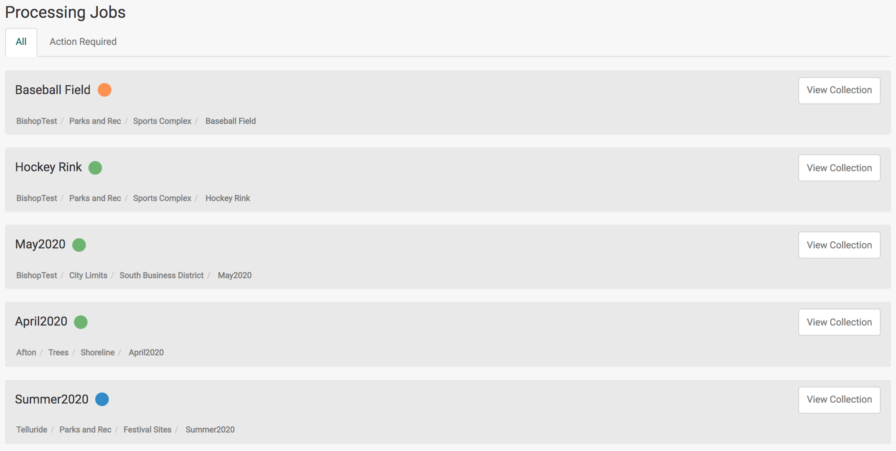

The list has two tabs:

- *All* shows every job. This tab is selected when the page opens.
- *Action Required* shows only jobs with a status of Failed.

Each processing job has a status indicator:

| Color | Status |
|---|---|
| Orange (blinking) | Processing |
| Green | Complete |
| Blue | Complete with messages (warnings or errors that did not stop the job) |
| Red | Failed |

### Job Steps

Clicking on the name of a processing job will expand it to show the status of each step. There are three types of steps:

1. **Upload:** monitors the process for uploading data to the IDM server and the post-processing steps needed to properly audit and store all data.
2. **Process:** monitors processing jobs that create derived products (image mosaics, elevation, and point clouds) from raw data previously uploaded.
3. **Store:** monitors the process for moving derived products from the processing environment to permanent storage.

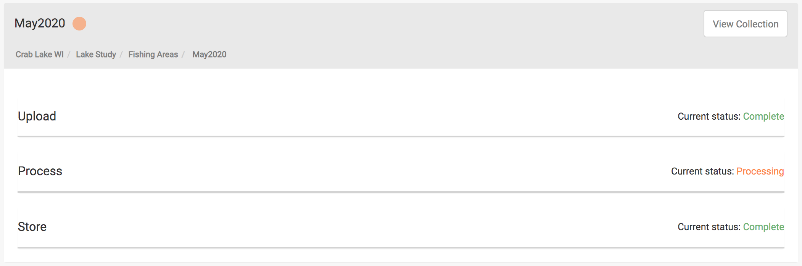

Each step shows its *Current status* and can be expanded to show more detail and provide information for troubleshooting and data management. For each task in the step, the details include the *Status*, the creation and last update dates, and a *Message*. Upload steps also show the *Sensor*.

A task that completed but has messages shows the status *Complete With Messages*.

While Open Drone Map is processing a collection, the Process step can also show a *Runtime Estimate*. IDM estimates the processing time from previous processing runs with a similar amount of raw data and similar settings. The estimate is shown only when IDM can calculate one. Longer estimates also show a more exact time in parentheses, for example "3 hours (2h 54m)".

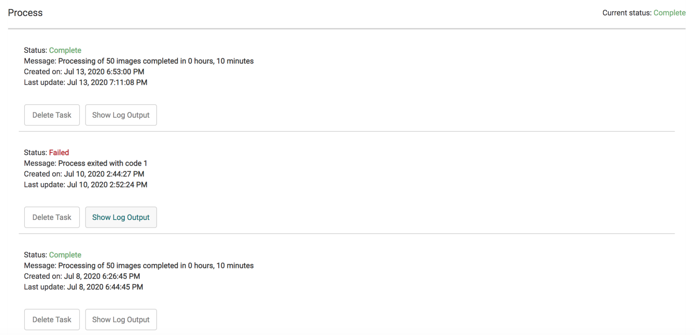

### Troubleshooting a Job

In the case that there are warnings or errors you can troubleshoot the issue by selecting the *Show Messages* button. Select *Hide Messages* to close the list.

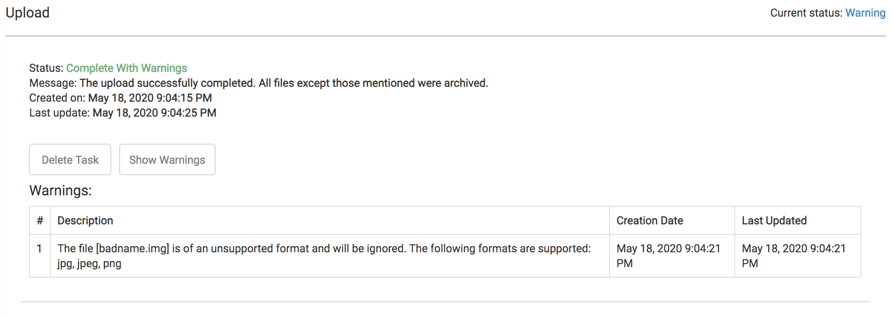

If the job has failed there will be a message explaining the issue:

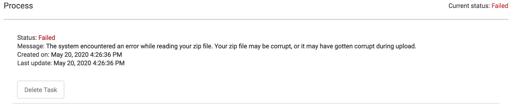

When a step has finished, more buttons may be available to view details and address any issues:

- *Show Detailed Log Output* shows the log from processing.
- *View ODM Run Information* opens the details of the Open Drone Map run, including its full log.
- *View Run Configuration* shows the settings used for a LiDAR processing run.

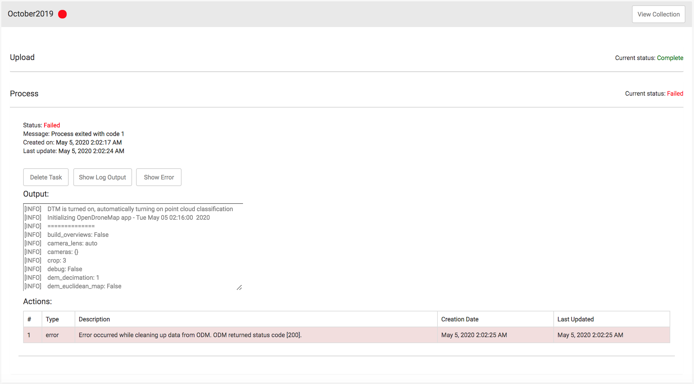

See the [Frequently Asked Questions](../faq.md) for common issues.

### After a Job Completes

Once processing has successfully completed you can [view the output products](products/viewing-products.md) by navigating to the products tab of the collection or by using the Products tab in the sidebar of the Site Viewer. There is a shortcut to the collection in the top of the processing job section:

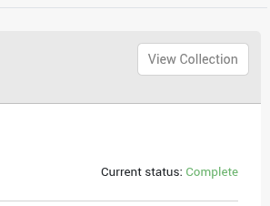
