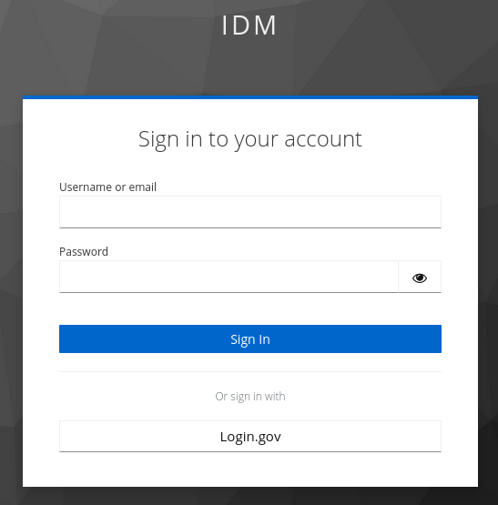
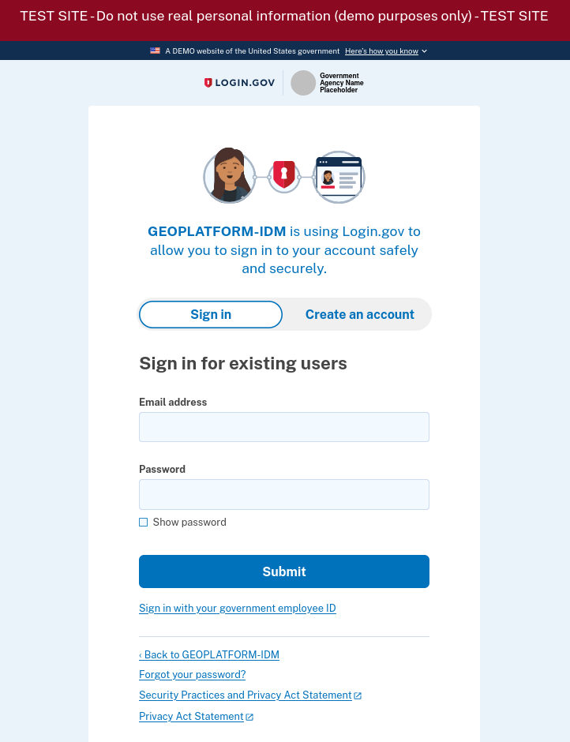

You can access the application at the following URL: <Deployment value="appUrl" />

This URL will direct you to the login screen.

1. Click the *Log in with GeoPlatform* button.

   
2. On the GeoPlatform sign in page, select the [Login.gov](https://login.gov/) option by clicking the button at the bottom of the form.

   
3. Fill out the Login.gov form to sign in.

   

:::warning

IDM currently is using a staging version of [Login.gov](https://login.gov/) for logging in. Most people already have accounts in that staging instance but if you have problems logging in please make sure you have an account in this staging environment by attempting to login or creating a new account if needed in this environment: [https://idp.int.identitysandbox.gov/](https://idp.int.identitysandbox.gov/)

:::

:::tip

Your account must be added to IDM by an administrator before you can sign in. See [Accounts](../administration/accounts.md) if you are an administrator.

:::
