The Site Viewer is your landing page and provides access to key functionality. Its sidebar and map are your primary tools for uploading and exploring data. To return to the Site Viewer from another page, choose *Site Viewer* from the navigation menu in the upper right of the application.

## IDM Sites

The highest level of the [data hierarchy](data-hierarchy.md) and first page of the Site Viewer is the IDM Sites page.

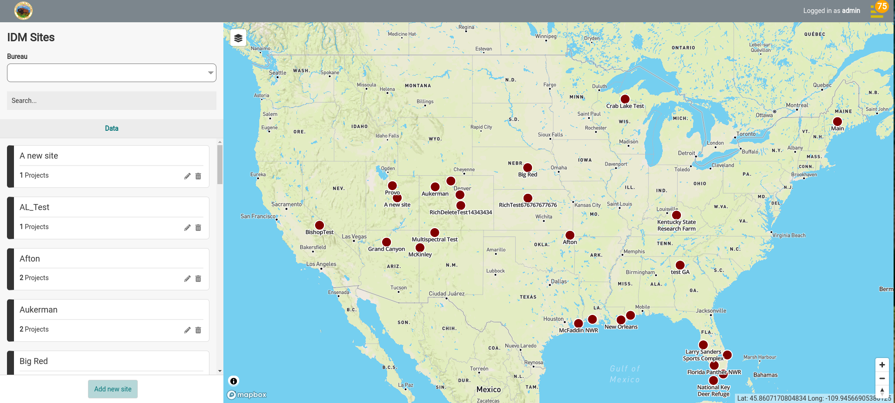

| Feature | Description |
|---|---|
| 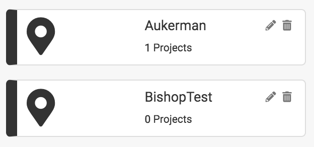 | The sidebar lists all sites contained in the map extent and filters based on the area of the map. Selecting (clicking on) a site in the sidebar will take you to the Projects level of the hierarchy and will highlight the site on the map.  The sidebar shows 50 sites at a time. When there are more, use the page controls at the bottom of the sidebar to move between pages. |
| 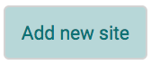 | If your site does not exist, select the “Add new site” button to [create a new site](../field-worker/organizing-data/sites.md). |
| 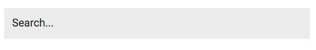 | Use the search bar for location based search and to search the hierarchy for existing data. |
| 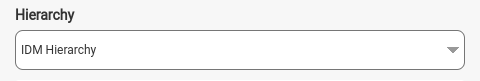 | Use the Hierarchy dropdown to filter the Sites in the sidebar by either the default IDM Hierarchy or any other custom hierarchies that have been integrated with the system. |
| 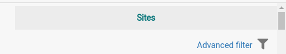  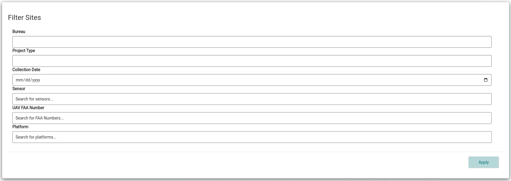 | Use the advanced filter to narrow down what’s shown in the sidebar. |
|  | View different basemaps by hovering over the layers icon in the upper right corner of the map and selecting Outdoors, Satellite, Streets or OSM. |
|  | Select the *Search GeoPlatform* button (magnifying glass) in the upper left corner of the map to search for published products in the area shown on the map, and add them to the map. See [Searching Know-STAC from IDM](../know-stac.md#searching-know-stac-from-idm). |
|  | Select the *Mapped Images* button (globe) in the upper left corner of the map to see every product, image set and GeoPlatform image currently on the map. The number on the button is how many layers are on the map. For each layer you can *Show* or *Hide* it, *Zoom* to it, *Remove* it from the map, or *Get Info* about it. |
| 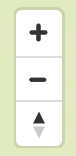 | Use the zoom controls to zoom in and out on the map - this will also filter the sites based on the map extent. |
| 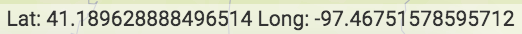 | The latitude and longitude of the location of your cursor on the map is shown on the bottom right of the map. |
| 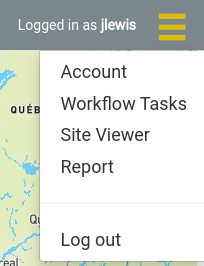 | Select the navigation menu icon in the upper right of the application to access other pages and navigate away from the Site Viewer, including the [Workflow Tasks](../field-worker/workflow-tasks.md) page where you monitor uploads and processing. |

## Navigating the Hierarchy

The sidebar is used to navigate the hierarchy to find a collection and/or products. Selecting a tile from the sidebar will take you to the next level of the hierarchy. The hierarchy navigation is Site → Project → Mission → Collection and the Collection will be where all raw images and produced outputs are accessed and managed.

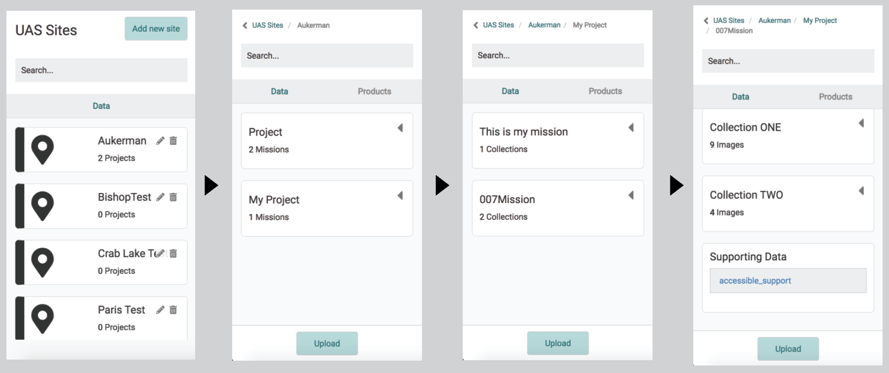

Once you have selected a site, the sidebar has additional functionality:

| Feature | Description |
|---|---|
| 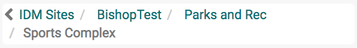 | Navigate to different levels of the hierarchy by clicking on the breadcrumb trail at the top of the panel. |
|  | You now have the option to view Data, Products, or Image Sets.  **Data** contains all hierarchy navigation and shows all items contained on that level of the hierarchy.  **Products** contains all output products contained in the current level of the hierarchy. For example if you are on the Project level you will see all produced output for every project contained in the site, if you select a project you will only see produced outputs for that project. See [Viewing Products](../field-worker/products/viewing-products.md).  **Image Sets** contains the image sets in the current level of the hierarchy. See [Image Sets](../field-worker/image-sets.md). |
| 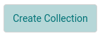 | The Create Collection button at the bottom of the panel will open the wizard where you will be able to configure and [create a Collection](../field-worker/organizing-data/collections.md). |
| 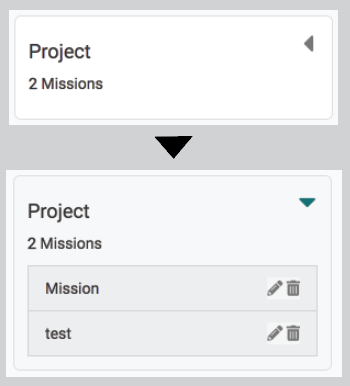 | Selecting the arrow in the upper right of any tile will expand the tile to reveal the next level of the hierarchy. |
