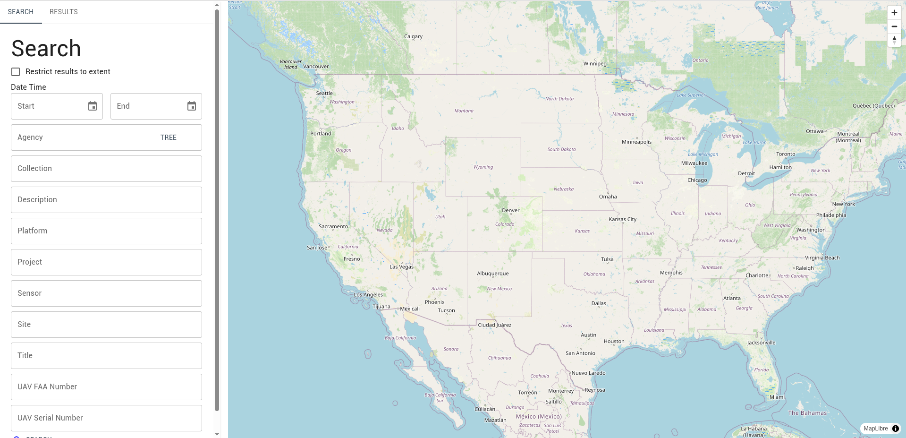
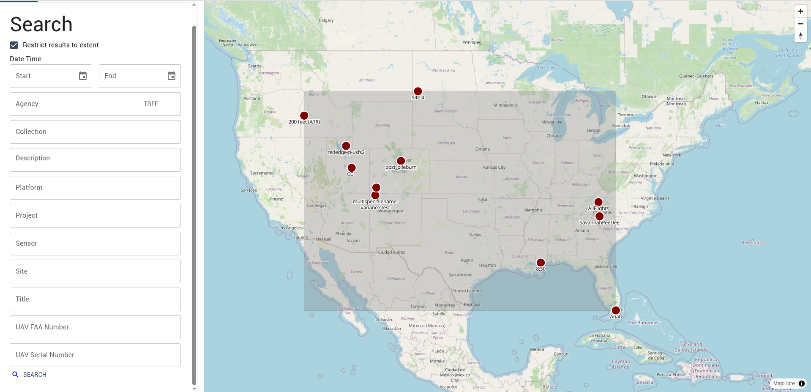
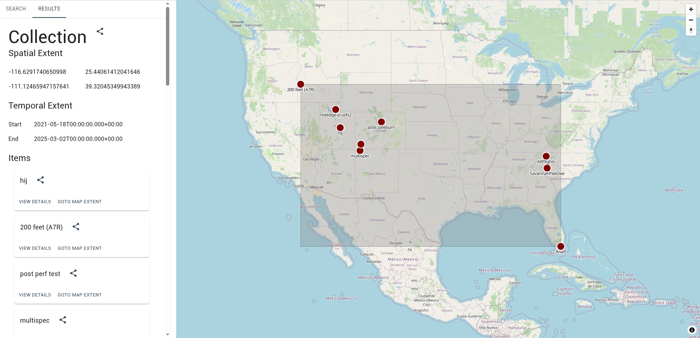
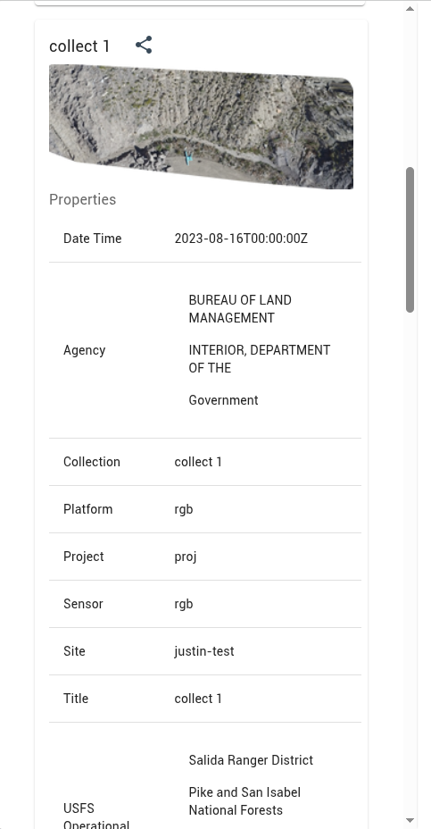
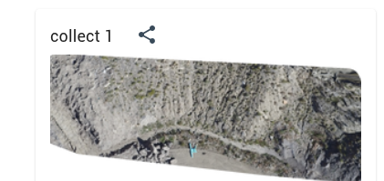
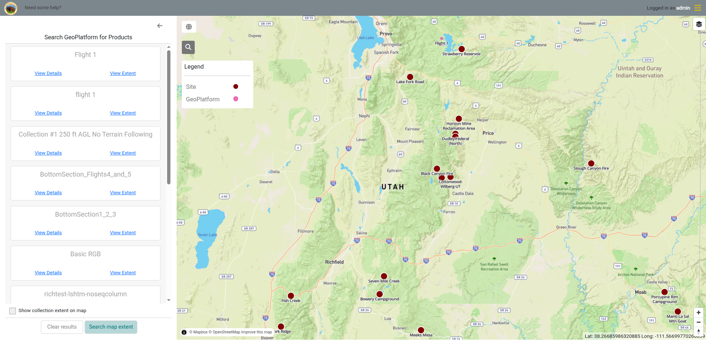

Products [published from IDM](field-worker/publishing-products.md) are registered in Know-STAC, where anyone can search for and access them.

## Access

:::info

All data on Know-STAC is publicly accessible. No credentials are needed.

:::

Know-STAC server: <Deployment value="knowStacUrl" />

## Overview

Know-STAC (Knowledge-Enabled STAC) is a semantic layer and storage application for making STAC searches interoperable across agencies and domains. The Know-STAC browser is a web application for searching Know-STAC.

## Layout

The Know-STAC application is a single page web application with the primary components being the map and sidebar.

### Sidebar

The sidebar is where most of the functionality is found. It contains two tabs that toggle between the search and results modes.

#### Search Tab

Search mode is where searches are configured and contains all the search parameters available.

#### Results Tab

Results mode displays the results of a search. The search results are a STAC collection with the STAC items contained within it. When a search is run the results mode is automatically enabled but can be manually toggled back and forth.

### Map

The map is where search result locations are shown. When Know-STAC items contain locations the points are displayed.

## Searching

All searching functionality can be accessed from the sidebar when the search tab is selected. The following search parameters are available from the search tab:

| Search Parameter | Description | IDM Integration Relevance |
|---|---|---|
| Restrict results to extent | Restricts the results of a search to the bounds of the map when clicking the search button. |  |
| Date range (start & end) | Restricts search results to data within the specified date range. | This filter uses the *collection date* field from IDM. |
| Agency | Restricts search results to the agency the data is sourced from. | This filter uses the *organization* field from IDM. |
| Collection | Restricts search results to the name of the collection the data comes from. | This filter uses the collection name from IDM. |
| Description | Restricts search results by the description of the data. | This filter uses the collection description from IDM. |
| Platform | Restricts search results to the name of the platform used to create the data. | This filter uses the platform name of the collection's UAV from IDM. |
| Project | Restricts search results to the name of the project the data was collected for. | This filter uses the project name from IDM. |
| Sensor | Restricts search results to the name of the sensor used to create the data. | This filter uses the sensor name field from IDM. |
| Site | Restricts search results to data within the specified site. | This filter uses the site name from IDM. |
| Title | Restricts search results by the title of the STAC item. | IDM uses the collection name as the title. |
| UAV FAA Number | Restricts search results to data from UAVs with the given FAA number. | This filter uses the *FAA Number* of the collection's UAV from IDM. |
| UAV Serial Number | Restricts search results to data from UAVs with the given serial number. | This filter uses the *Serial Number* of the collection's UAV from IDM. |

### Basic Search Behavior

The sidebar has two modes, search and results, as indicated by the two tabs at the top. Both modes can be toggled manually. When a search is run the results tab is automatically activated to show the results of the search.

### Search by Map Extent

1. Check the *Restrict results to extent* box in the sidebar.
2. Push the *Search* button at the bottom of the sidebar.

## Exploring Results

When a search is run the results tab is enabled automatically and the resulting STAC collection, metadata, and STAC items are shown in both the sidebar and the map.

### Collection Properties

The STAC collection metadata is at the top of the search results. It contains the spatial extent and the temporal extent.

| Metadata Property | Description |
|---|---|
| Spatial Extent | The spatial extent of all the results of the search (cumulative STAC items). |
| Temporal Extent | The min and max time range of all the data returned. |

### Items

The items section includes a list of all the STAC items in the collection.

#### Item Properties

Know-STAC item properties are all the properties that are included on a STAC item and searchable within Know-STAC. They can be viewed by clicking the *view details* button to expand a STAC item.

| Property | Description | IDM Integration Reference |
|---|---|---|
| Date Time | The date that the data was collected. | The collection's *Collection Date*. If it is empty, the *Collection End Date* is used, and if that is also empty, the date the product was last updated. |
| Agency | The organization who manages the data or that created the data. | The site's organization, followed by each of its parent organizations. |
| Collection | The name of the collection. | The collection name. |
| Description | A description of the data. | The collection description. |
| Platform | The name of the platform used to collect the data. | The platform of the collection's UAV. |
| Project | The name of the project that the data was collected for. | The project name. |
| Mission | The name of the mission that the data was collected for. | The mission name. |
| Sensor | The name of the sensor used to collect the data. | The collection's sensor. |
| Site | The name of the site that the project is within. | The site name. |
| UAV FAA Number | The FAA number of the UAV used to collect the data. | The *FAA Number* of the collection's UAV. |
| UAV Serial Number | The serial number of the UAV used to collect the data. | The *Serial Number* of the collection's UAV. |
| Title | The name of the STAC item. This is a standard STAC metadata property. | The collection name. |
| Operational | The geographic locations the site falls within, from the top of the hierarchy down. | The site's location in the [custom hierarchy](administration/custom-hierarchies.md) synchronized from GeoPrism Registry (STAC property `geoplatform:operational`). Empty if no custom hierarchy is synchronized or the site isn't in it. |
| Assets | The list of assets within this STAC item. An asset is an actual dataset. A STAC item can have one or more assets. | See below. |

For products uploaded directly to a project or mission instead of a collection, *Title* and *Collection* contain the name of that project or mission.

IDM adds these assets to a STAC item, depending on which files the product has:

| Asset | Description |
|---|---|
| Ortho | The orthomosaic GeoTIFF. |
| Elevation | The digital elevation model (DEM) GeoTIFF. |
| Overview | A PNG image of the orthomosaic. |
| Thumbnail | A small PNG preview of the orthomosaic. |

Point clouds and other product files are not included as assets.

#### Sharing an Item

Each item has a share button that will open a new browser tab with the STAC definition as JSON.

## Searching Know-STAC from IDM

You can also search Know-STAC without leaving IDM, and view the results on the Site Viewer map. In IDM, Know-STAC is called *GeoPlatform*.

1. In the Site Viewer, pan and zoom the map to the area you want to search.
2. Select the *Search GeoPlatform* button (magnifying glass) in the upper left corner of the map. The *Search GeoPlatform for Products* panel opens in the sidebar.

   
3. Click *Search map extent*. The panel lists the published products within the area shown on the map.
4. For each result:
   - Click *View Details* to see its thumbnail and properties.
   - Click *View Extent* to zoom the map to it.
   - To add it to the map, open *View Details*, choose the image in the *Asset* list, and check *Add to map*.
5. Check *Show collection extent on map* to outline the results on the map.
6. Click *Clear results* to start a new search, or the back arrow to close the panel.

Products you add to the map are listed in the *Mapped Images* panel (globe button), where you can show, hide, zoom to or remove them.

## Sharing Know-STAC Application Pages

Know-STAC allows for sharing results by URL. Simply copy the URL for a search from the browser.

## Contributing to Know-STAC

To add data from IDM to Know-STAC, [publish the product](field-worker/publishing-products.md). Unpublishing a product removes it from Know-STAC.
